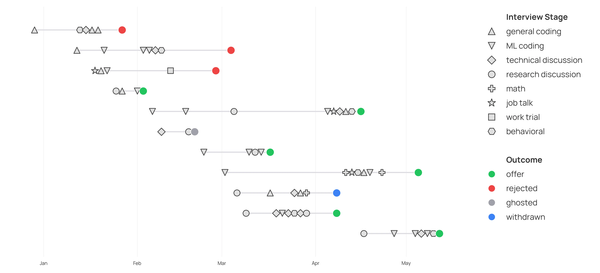

# 行业求职笔记（Notes on the Industry Job Search）

> 译自：<https://alisawuffles.github.io/blog/job-search/>（页面标注发表日期 2026-06-20）
> 作者：Alisa（华盛顿大学 NLP 方向博士生）
> 译注日期：2026-11-15。译注集中放在文末。

在我读博的大部分时间里，工业界求职在我心目中就像一顶分院帽[^1]：高年级的博士生会"消失"好几个月，然后再出现时，命运已然落定。哪怕身边的密友一个个毕业、入职，除了偶尔收到一句"我还活着"，我对他们经历了什么几乎一无所知。等终于轮到我，才发现整个过程远比想象中吃力——我仿佛是在这局牌打到一半时，才学会这游戏的规则。

事后回头看，我的许多经历其实是普遍的，路上学到的许多东西如今看来也近乎常识。写这篇帖子，是想提供一个"这条路上可能是什么样"的真实样本，希望能为不久前的、站在我当年位置上的那个人，把求职这件事讲得少一点神秘。

先交代一下我的背景。我在华盛顿大学 NLP（自然语言处理）方向读了六年博士，在临近毕业时申请的是 Research Scientist / MTS（Member of Technical Staff，技术组成员）这类岗位。我一辈子都在学校里待着，本来恨不得永远当博士生，直到导师们最终把我"推"了出去。读博前期我几乎没想过之后要做什么，做事全凭哪个点子好玩。这让我换过很多次方向，幸运的是，最后两年我在 tokenizer（分词器）这条线上保持了连贯的产出——部分原因也是做得开心。我觉得，在一个方向上建立起"专长"，是求职中让我脱颖而出的关键。

# 我的时间线

下面的时间线图展示了我从开始面试到拿到结果的全过程（灵感来自 [Nathan Lambert 的帖子](https://natolambert.com/writing/ai-phd-job-hunt)）：灰色图标是面试，彩色圆点是结果。注意：**ghosted**（"被鸽了"）指公司自始至终没有告诉我结果或下一步安排；**withdrawn**（"主动退出"）指我在拿到几个令人心动的 offer 之后，礼貌地告诉某家公司我不再继续了。总计：我在 **11 家公司面试了 57 场**。图中没有画出的，还有 46 通与 recruiter（招聘专员，公司里负责对接候选人的 HR 类角色）的电话、16 次拿到 offer 之后的深入沟通，以及求职前和求职中数不清的非正式 networking（社交联络）。

**投递顺序。** 每一家的流程什么时候启动，我是综合几个因素决定的：自己准备得如何、公司给的压力、我预期他们动作有多快、我对他们的兴奋程度，以及一些不太刻意的因素（比如拖延）。通行的建议是：先拿几家公司练手，再安排其余流程，让所有 offer 大约同时到手，好在谈判中互相抬价。我认为这个思路在精神大方向上是对的，但想补充几点考虑：

- 练手面试确实有用，但也要明白你的精力是有限的——别等走到真正心仪的公司时，人已经燃尽了！
- 时机上有许多你控制不了的外部因素，比如公司有没有 headcount（招聘名额）、哪些团队正在招人，这些有时比你的准备更影响结果。你可以通过朋友和 recruiter 获得一些内部风声。
- deadline 的弹性其实很大，offer 时间不必卡得那么精确。Recruiter 知道你有别家流程要走，拖延 offer 和决策时间也各有办法。话虽如此，也有出了名的例外（所谓"exploding offer"，即要求几天内立刻签、不签作废的 offer），所以提前打听"这家公司通常给候选人多久考虑时间"很重要。

**拿到第一次面试。** 说句大实话：读博期间做出像样的工作、多交朋友、多合作！要拿到第一次面试，有时需要公司内部有人为你引荐背书。你可以早早为自己铺路：在学术会议上活跃一点、广泛地找人合作、参加社交活动（当然，这对每个人都不是易事——至少对我来说不是——所以也要照顾好自己的精力和舒适区）。求职期间，主动联系认识的人（甚至不认识的人），询问机会。事实上，找工作的很大一部分工作是和多年未联系的人重新接上头——这很正常，是预期之内的，而且事后发现，这是整个过程中一个美妙的副产品。

# 面试的种类

我认为面试大致有以下几类。总体而言，**技术知识与能力的权重远高于科研经历**——尽管后者多半是把你带进面试间的那张门票。

**ML 编码（ML coding）。** 这是远远最常见的一类。题目可能要求你实现一个给定的模型架构、一种解码（decoding）策略、一个传统机器学习算法，有时则更有创意。`PyTorch` 必须熟练到手；偶尔会要求只用 `numpy`——比如让你从零手写反向传播（backprop）——但不会要求你背熟 numpy 的语法。

**通用编程（general coding）。** 基本就是 LeetCode（在线算法刷题平台），偶尔加点花样。在这一项上打牢基础很值，因为里面的概念也常常出现在 ML 编码题里。

**技术讨论（technical discussion）。** 不写代码，但技术含量很高。有时是围绕一个话题的深入讨论，比如：为回答某个研究问题或达成某个目标，你会怎么设计实验。面试官一般会追问你的设计选择，请你点评一些假想的实验结果，并接着设计后续实验。另一些场合则是连珠炮式的快问快答（位置信息有哪些不同的编码方式？什么是 5D 并行？PPO 和 GRPO 有什么区别？），目的是确认你对本领域的知识覆盖面。前者考察你怎么思考，后者考察你懂多少。

**研究讨论（research discussion）。** 这是读博期间练得最多的一种对话。面试官通常先请你讲一个过去的项目，之后的讨论随之展开；也可能问到简历上其他论文。准备这类讨论时，退后一步想清楚这几件事会有帮助：你为什么选择做这些题目、一路上形成了哪些见解和观点、你认为哪些未来方向有前途。我还按岗位调整研究介绍的讲法——面试官也疲惫，命中恰当的关键词，能让他们更容易相信你的背景与岗位相关。

**行为面试（behavioral）。** 除了偶尔掺入关于 AI 安全或社会影响的问题，就是教科书式的行为面试。把读博期间难忘的故事一一列举出来，映射到那些常见行为题上，面试时就能瞬间检索到对应的素材。我第一场上就挂了，因为我进场时心想"我显然很'有品行'啊"，结果在最简单的问题上大脑一片空白。相信我，一边在面试的重压下打捞模糊的记忆、一边还要当场组织语言，最后被面试官来一句"你没有回答问题"——这种痛，独一份。

**数学（math）。** 部分公司有数学轮，范围从有趣的逻辑谜题到真刀真枪的纸笔推导。我建议复习概率、线性代数和微积分。

**工作报告（job talk）。** 各家要求有差异，但相比学术报告通常更短，聚焦一篇论文或一条研究线。我的报告全程讲 tokenizer：大部分时间放在一作工作上，然后简要带过几篇二作和正在进行的工作——庆幸它们恰好能串成一条线。

# 准备

为面试而学习，绝对是你时间回报最高的用法。我的体验非常像重读了一遍本科：记笔记（我的 [LLM 笔记](https://alisawuffles.notion.site/alisa-s-book-of-llms)，整个过程中一直在写，以及我的[数学笔记](https://alisawuffles.notion.site/math-notes)，为某一场上过战线的面试专门整理的那一份）、画图、做习题、在咖啡馆一坐一整天，把基础 ML 概念从头到尾掰开揉碎弄懂。技术面试很难，它考察的能力需要专门抽出时间来练——光做科研练不到。对我和我聊过的绝大多数人来说，求职本身就是一份全职工作。

我的起步方式是看完斯坦福 [Language Modeling from Scratch](https://cs336.stanford.edu/spring2025/)（从零构建语言模型）课程的全部讲义。它帮我标出了需要学习的版图，把散落在脑子里的概念拼成了一张领域全景图。打完基础后，我把剩下的时间用于逐个深入概念：读相关博客和论文，大量地和 ChatGPT、Claude 讨论，以及亲手从零实现东西。**作业 1**（[Homework 1](https://github.com/stanford-cs336/assignment1-basics)）非常关键：实现并调试 Transformer 在面试中反复出现，把它练成肌肉记忆回报巨大，在这上面丢分实在不值。练习时请务必**关掉 AI 辅助**写代码，模拟真实面试环境——否则你一定会低估自己平时有多依赖它！

我还发现，每场面试都不一样，都值得做一点——有时是大量——针对性准备。你通常能从面试说明、公司感兴趣的方向、recruiter 透露的提示和公司的口碑里，大致推断出一场面试的考试范围。在面试高峰期，我的大脑一直在"换内存"：把与眼前这场最相关的知识调入脑内保持新鲜。最好的比方是：每场面试都是一门略有不同的数学或 CS 课，你一节课没去上，而现在，你只有大约三天来应付期中考试。

**面试当天。** 大概是我上年纪了，但什么都不如前一晚睡够。我第一场面就犯了这错：考前把 LLM 推理的所有细节硬塞进脑子，只睡了两个小时——临塞的知识一个都没考到，我反而在一个 off-by-one（差一个的边界）错误上浪费了十分钟，因为大脑根本转不动。面试之后，记得趁热记下复盘笔记，对后续复习和总结都有用。

**意外的收获。** 备考给我带来巨大的"副产品"。知识面变宽，直接提升了我作为研究者的自信：说话更有底气，因为不再担心知识盲区被人戳穿；盲区真的出现时，我也不用再藏着掖着。我真心觉得，如果读博早期就补上这些功课，我能想到的问题空间、能生出的点子都会大不一样，我主动去找人交流的意愿也一定更多。神奇的是，备考还让我手头的项目进展显著变快：我生出了以前根本够不着的技术想法，能做更多技术工作——这种感觉让人兴奋。

# 谈判

令我震惊的是，拿到 offer 之后，工作远没有结束。恰恰相反，接下来是一段（可能颇长的）时期：你要更多了解你的选项，并谈判你的 offer。这包括与未来的同事/主管见面、参观午餐会、和 recruiter 多轮通话。那段时间我要同时处理的沟通多到令人窒息，总有些邮件让我愧疚地拖着没回。

实话是：谈判很难。读博没有教过我们任何谈判的东西，而且和面试不同，**这一关没法靠刷题攻克**。论对市场的了解、论谈判技巧，你都不如 recruiter，而和你谈话的每个人都对你另有所图。你可能想："offer 我满足了，我要不考虑薪酬、只凭本心做决定！"了解自己的价值观当然好！但如果你不谈判，那就是亏待了自己。初始 offer 在设计上就留有谈判空间；recruiter 甚至常直白地邀请你入局，比如"我不指望你接受我们的第一份报价"。在这件事上花几个星期的心力，字面意义上可以相当于按初始报价干上好几年。

在这个阶段，一定要借助朋友：向他们取教"和 recruiter 打交道"的门道，多要几个数据点来校准你的要价。每次和 recruiter 通话前，我都会写下：哪些信息我愿意说、哪些不愿意，以及可以照念的句子。offer 阶段，我会预判他们可能提的问题、可能打的牌，认真准备既能替自己争取、又说起来顺口的回应。虽然费时，但对过程的每一处都用心，是真正值得的。

# 结语

这篇帖子聚焦的是求职中"具体"的部分，但对我个人而言，很大一部分经历其实是在管理求职带来的一切情绪。社会评价的眼光如影随形：和同辈互相比较并不好受；每个人都对你的去向有意见；人们会反常地对你的生活进展投入过多关注。我还要在信息不全的情况下，面对一个巨大的决策空间——那些看似无解的小选择（比如"先联系谁"）影响却大得不成比例。坦率地说，有好几个月，我焦虑、沮丧、生活的其他部分都失了常。希望你比我找到更多乐趣；如果没有，也请知道，你并不孤单。

几个月来，我一直朝读博的终点狂奔；真到了终点，要合上这一页，我却无比不舍。读博是一段特殊时光：我们唯一的工作就是有好的想法、把它们做出来，作为研究者学习和成长——**不用**发愁眼前就要锁定一份真正的工作。所以，我希望这篇帖子能帮你提前心理上预备未来（我也当然承认，工业界此刻的引力有多么大）；同时，我也希望你知道这段时光独一无二，值得好好珍惜。毕竟这两个目标并不矛盾——我始终发现，当我开心、当我穷追那些脑海裡放不下的问题时，我的工作是做得最好的。

* * *

# 附录：学习资源

（以下条目顺序与原文一致；原页面为无序列表，无优先级。）

- [LeetCode 75](https://leetcode.com/studyplan/leetcode-75/) / [Neetcode Blind 75](https://neetcode.io/practice/practice/blind75)
- [斯坦福 CS336：Language Modeling from Scratch](https://cs336.stanford.edu/spring2025/)
- [Self-Attention & Transformers](https://web.stanford.edu/class/cs224n/readings/cs224n-self-attention-transformers-2023_draft.pdf)
- [The Illustrated GPT-2](https://jalammar.github.io/illustrated-gpt2/)
- [Backpropagation](https://cs231n.github.io/optimization-2/)
- [Introduction to Policy Gradient for LMs](https://ivison.id.au/2026/02/09/policy-gradient.html)
- [Lightweight Guide to understanding GRPO and RL principles](https://gitlostmurali.com/blog/grpo-intro)
- [How to Scale Your Model](https://jax-ml.github.io/scaling-book/)

---

## 译注

[^1]: 分院帽：《哈利·波特》中把新生分入各学院会说话的帽子。原文借此比喻"博士生进去、结果出来"的神秘感。
- 图中图标与配色含义见正文说明；原图未作改动，存于 `../assets/timeline.webp`。
- off-by-one：编程里差 1 的典型边界错误（如循环多跑/少跑一次）。
- 术语对照见仓库根目录 [`glossary.md`](../glossary.md)。
