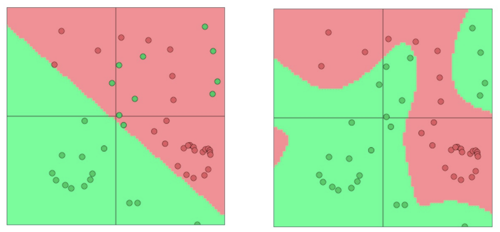
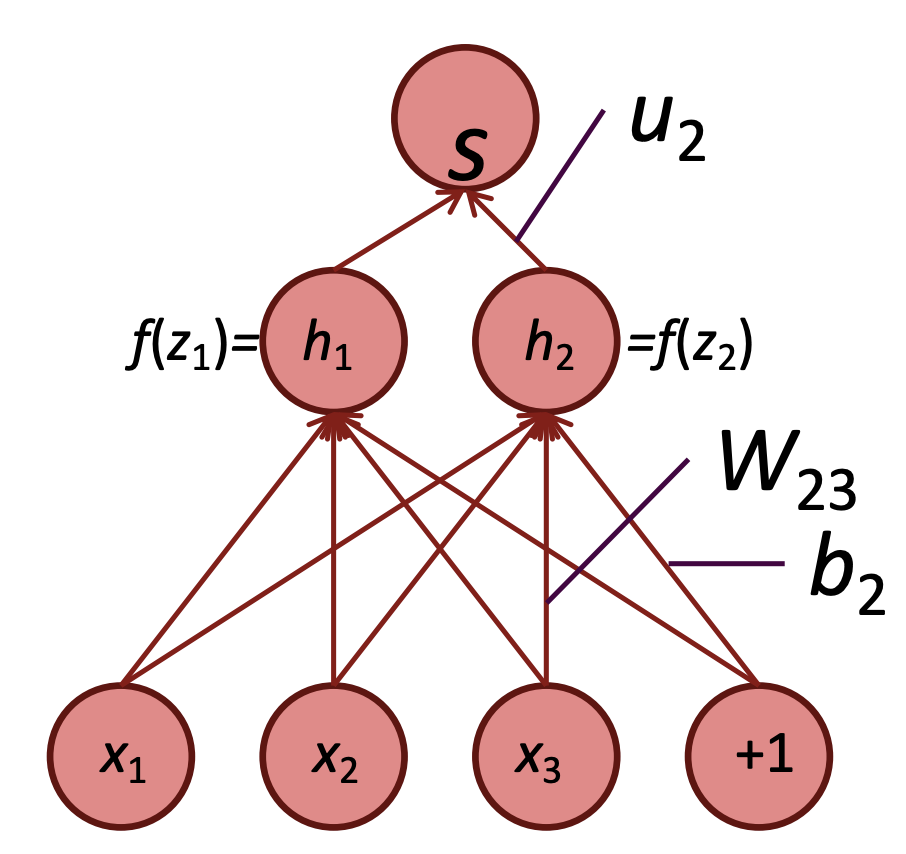
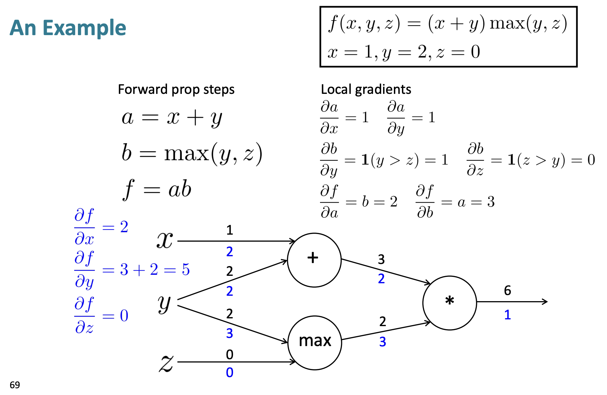

# 第一章　神经网络基础（Neural net basics）

> 译自 Alisa's Book of LLMs "Neural net basics" 一节；底稿与约定见 [`05-scaling-laws.md`](05-scaling-laws.md) 页眉说明。原图位于 `../snapshots/llm-book/assets/`。

## 多层感知机（Multi-layer perceptrons）

- **多层感知机**（multi-layer perceptron, MLP）：由输入层、至少一个隐藏层、输出层组成的全连接网络
  - 常被当作"前馈网络"的同义词使用，尽管 FFN（前馈网络）严格来说是更大的范畴——只要信息单方向流动都算

- 单个神经元做的事：对输入加权求和、加上偏置、再过一遍激活函数
  - $\mathbf x\in\mathbb R^n$ 是输入向量（上一层传来的激活值）
  - $\mathbf w\in\mathbb R^n$ 是权重向量（连入这个神经元的各条边的权重）
  - $b\in\mathbb R$ 是偏置
  - $f$ 是激活函数

$$y=f\left(\sum_{i=1}^n w_i x_i+b\right)=f(\mathbf w^\top\mathbf x +b)$$

- 有 $n_\text{in}$ 个输入、$n_\text{out}$ 个神经元的一层，可以用矩阵乘法一次算完
  - 于是 $\mathbf x\in\mathbb R^{n_\text{in}}$（列向量）
  - 把所有权重向量叠成权重矩阵 $W\in\mathbb R^{n_\text{out}\times n_\text{in}}$
    - 每一行就是一个神经元的入边权重
  - 偏置叠成向量 $\mathbf b\in\mathbb R^{n_\text{out}}$
  - 输出的隐状态形状为 $\mathbf h\in\mathbb R^{n_\text{out}}$

$$\mathbf h=f(W\mathbf x+\mathbf b)$$

- 实践中我们一次处理 $m$ 条输入的批次！
  - 这时把输入排成矩阵的行：$X\in\mathbb R^{m\times n_\text{in}}$
  - 按惯例把 $W$ 换成形状 $\mathbb R^{n_\text{in}\times n_\text{out}}$
    - 每一列是一个神经元的入边权重
  - 这一层就写成

$$H=f(XW+\mathbf b)$$

  - 其中 $\mathbf b$ 广播成 $m\times n_\text{out}$

> 数学记号里，一个线性层拿到 $X\in\mathbb R^{m\times n_\text{in}}$，施加 $W\in\mathbb R^{n_\text{in}\times n_\text{out}}$，算 $XW+b$。
> 在 PyTorch 里，权重矩阵 `W` 实际按 $n_\text{out}\times n_\text{in}$ 存储。前向传播会对 `W` 转置，计算 `X @ W.T`，即 $(m, n_\text{in})\times(n_\text{in},n_\text{out})$。转置本身不花成本，因为它只改变步长（stride）。这样存是为了让 $W$ 的梯度天然就是 $n_\text{out}\times n_\text{in}$，与 $W$ 的形状一致。

- 来推一遍 $Z=XW+b$ 的反向传播

$$\begin{gather*}\frac{\partial L}{\partial X}=\frac{\partial L}{\partial Z}W^\top\quad (m,n_\text{out})\times (n_\text{out},n_\text{in})=(m,n_\text{in}) \\ \frac{\partial L}{\partial W}=X^\top\frac{\partial L}{\partial Z}\quad (n_\text{in}, m)\times (m,n_\text{out})=(n_\text{in},n_\text{out}) \end{gather*}$$

  - 同一个偏置 $\mathbf b\in\mathbb R^{n_\text{out}}$ 加到了每条样本上，每条样本都会产生自己那份对 $\mathbf b$ 的梯度
    - 这些梯度于是会累加：

$$\frac{\partial L}{\partial b_j}=\sum_{i=1}^m\frac{\partial L}{\partial z_{ij}}\cdot\frac{\partial z_{ij}}{\partial b_j}=\sum_{i=1}^m\frac{\partial L}{\partial z_{ij}}\cdot 1=\sum_{i=1}^m\frac{\partial L}{\partial z_{ij}}$$

  - 最直观的理解方式：
    - 已知 $\partial L/\partial X$（若 $X$ 只有一条样本）等于 $\partial L/\partial Z \cdot W^\top$，形状 $(n_\text{in})$
    - 当 $X$ 有批次维度时，我们要求的输出形状是 $(m,n_\text{in})$
    - $Z$ 的第 $i$ 行只依赖 $X$ 的第 $i$ 行（批次内样本互不干扰）
    - 所以把每行的梯度摞起来即可
  - 通用经验：先推单条样本的雅可比（干净、就两维）
    - 若张量在批次间共享（如 $W$）：批次维度被求和消掉 → 收缩（矩阵乘法，批次维当内维）
    - 若张量不共享（如 $X$、激活值）：批次维度保留 → 堆叠（矩阵乘法，批次维留在外侧）
  - 注意 PyTorch 的实现是 $Z=XW^\top$、$W\in\mathbb R^{n_\text{out}\times n_\text{in}}$，此时长这样

$$\begin{gather*}\frac{\partial L}{\partial X}=\frac{\partial L}{\partial Z} W\quad (m,n_\text{out})\times (n_\text{out}, n_\text{in})=(m,n_\text{in}) \\ \frac{\partial L}{\partial W}=\left(\frac{\partial L}{\partial Z}\right)^\top X\quad (n_\text{out}, m)\times (m,n_\text{in})=(n_\text{out},n_\text{in}) \end{gather*}$$

## 激活函数（Activation functions）

- **sigmoid** $\sigma(x)\in(0,1)$

$$\sigma(x)=\frac{1}{1+e^{-x}}$$

  - 适合把输出解释成概率
  - 不用在神经网络的隐藏层
    - 梯度会消失：导数 $\sigma(x)(1-\sigma(x))\le 0.25$
    - 不以 0 为中心，单个节点传下去的梯度会全正或全负（取决于上游梯度符号）

- **tanh** $\in(-1,1)$

$$\tanh(x)=\frac{e^x-e^{-x}}{e^x+e^{-x}}=2\sigma(2x)-1$$

  - 导数最大为 1.0（在 $x=0$ 处），依然可能消失
  - $\tanh^\prime$ 的因子只会缩小，因为 $\tanh^\prime(z)=1-\tanh^2(x)\in(0,1]$

- **softmax** → 概率分布

$$\text{softmax}(\mathbf x)_i=\frac{e^{x_i}}{\sum_j e^{x_j}}$$

  - 带温度（temperature）的版本：

$$\text{softmax}(\mathbf x/T)_i=\frac{e^{x_i/T}}{\sum_j e^{x_j/T}}$$

- **ReLU** $\in(0,+\infty)$

$$\mathrm{ReLU}(x)=\max(x,0)$$

  - 导数在 $x>0$ 时为 1，$x<0$ 时为 0
  - 死亡的 ReLU（dying ReLUs）：若某个预激活值永远为负（对所有输入都负），它将永远收到零梯度
    - 训练过程中一部分网络可能就此"死掉"

- **Leaky ReLU** $\in(-\infty,+\infty)$

$$\text{LeakyReLU}(x)=\begin{cases}x&\text{若 }x>0\\\alpha x&\text{若 }x\leq0\end{cases}$$

  - 修复死亡 ReLU 问题

- **Swish**（平滑、非单调）

$$\text{Swish}(x)=x\cdot\sigma(x)$$

- **GLU**（门控线性单元）：一条线性投影产出"内容"，另一条产出"门"

$$\text{GLU}(x)=xW_1\odot\sigma(xW_2)$$

- **SwiGLU**：把 GLU 里的激活函数换成 Swish

$$\text{SwiGLU}(x)=(x W_1)\odot \text{Swish}(xW_2)$$

- 没有非线性，神经网络就只能做线性变换
  - 多层会被"编译"成一个线性变换：$W_1 W_2x=Wx$
  - 没有非线性，加层不会带来任何额外的表达能力
  - 带上非线性的多层网络，就能逼近任意复杂的函数！



## 梯度（Gradients）

- 对某个变量的导数，告诉你整个表达式对这个变量取值的**敏感度**
  - 若 $\partial f/\partial x=3$，把 $x$ 改动一个很小的 $h$，$f(x)$ 就会变化约 $3h$

$$\frac{df(x)}{dx}=\frac{f(x+h)-f(x)}{h}$$

- 梯度 $\nabla f$ 是全部偏导数组成的向量
- 对一个 $m$ 输出、$n$ 输入的函数，**雅可比矩阵**（Jacobian）是 $m\times n$ 的偏导数矩阵

$$\begin{gather*}f(\mathbf{x})=[f_1(x_1,\dots,x_n),\dots,f_m(x_1,\dots,x_n)] \\ \frac{\partial f}{\partial x}=\begin{bmatrix}\frac{\partial f_1}{\partial x_1}&\cdots &\frac{\partial f_1}{\partial x_n}\\\vdots&\ddots&\vdots\\\frac{\partial f_m}{\partial x_1}&\cdots&\frac{\partial f_m}{\partial x_n}\end{bmatrix} \end{gather*}$$

- 对一个 $n$ 输入、标量输出的函数，**黑塞矩阵**（Hessian）是 $n\times n$ 的二阶偏导矩阵，$H_{ij}=\frac{\partial^2 f}{\partial x_i\partial x_j}$
  - 损失函数的黑塞矩阵描述损失面的**弯曲程度**
- 链式法则
  - 一元函数复合：导数相乘

$$\begin{gather*}x=3y,\ y=x^2 \\ \frac{dz}{dx}=\frac{dz}{dy}\frac{dy}{dx}=3\cdot 2x=6x \end{gather*}$$

  - 多元函数：雅可比相乘

$$\begin{gather*}\mathbf h=f(\mathbf z),\ \mathbf z=\mathbf W\mathbf x+\mathbf b \\ \frac{\partial\mathbf h}{\partial\mathbf x}=\frac{\partial\mathbf h}{\partial\mathbf z}\frac{\partial\mathbf z}{\partial\mathbf x}=\cdots \end{gather*}$$

- 神经网络记号设定

$$\begin{gather*}\mathbf x\quad\in\mathbb{R}^d \\ \mathbf h=f(\mathbf W\mathbf x+\mathbf b)\in\mathbb{R}^k \quad \mathbf W\in\mathbb{R}^{k\times d},\mathbf b\in\mathbb{R}^k \\ \mathbf s=\mathbf u^\intercal\mathbf h\in\mathbb{R} \quad \mathbf u\in\mathbb{R}^k \end{gather*}$$



- 对逐元素激活 $\mathbf h=f(\mathbf z)$（$\mathbf h,\mathbf z\in\mathbb{R}^n$），${\partial\mathbf h}/{\partial\mathbf z}$ 是什么？

$$\left(\frac{\partial \mathbf h}{\partial \mathbf z}\right)_{ij}=\frac{\partial h_i}{\partial z_j}=\frac{\partial}{\partial z_j}f(z_i)=\begin{cases}f'(z_i)&\text{若 }i=j\\0&\text{否则}\end{cases}$$

  - 雅可比是对角矩阵：

$$\frac{\partial\mathbf h}{\partial \mathbf z}=\begin{bmatrix}f'(z_1)&&\\&\ddots&\\&&f'(z_n)\end{bmatrix}=\mathrm{diag}(f'(\mathbf z))$$

- 常用雅可比

$$\begin{gather*}\frac{\partial}{\partial \mathbf x}(\mathbf W\mathbf x+\mathbf b)=\begin{bmatrix}\ddots&&\\&\frac{\partial z_i}{\partial x_j}\\&&\ddots\end{bmatrix}=\begin{bmatrix}\ddots&&\\&W_{ij}\\&&\ddots\end{bmatrix}=\mathbf W \\ \frac{\partial}{\partial \mathbf b}(\mathbf W\mathbf x+\mathbf b)=\mathbf I \\ \frac{\partial}{\partial \mathbf z} f(\mathbf z)=\mathrm{diag}(f'(\mathbf z)) \\ \frac{\partial}{\partial \mathbf u}(\mathbf u^\intercal\mathbf h)=\mathbf h^\intercal \end{gather*}$$

- 其他常用导数

$$\begin{gather*}\frac{d}{dx} \frac 1x =-\frac{1}{x^2} \\ \frac{d}{dx} e^x = e^x \\ \frac{d}{dx} \sigma(x) = (1-\sigma(x))\sigma(x)\quad\text{[用商法则]} \\ \frac{d}{dx}\log x = \frac 1x \\ \frac{d}{dx}\tanh(x) = 1-\tanh^2(x) \end{gather*}$$

  - sigmoid 导数怎么来：

$$\begin{align*}\frac{d}{dx}\sigma(x) = \frac{d}{dx}(1+e^{-x})^{-1} \\ &=(1+e^{-x})^{-2}\cdot e^{-x}\quad\text{链式法则} \\ &= \frac{e^{-x}}{(1+e^{-x})^2} \\ &= \frac{1}{1+e^{-x}}\cdot\frac{e^{-x}}{1+e^{-x}} \\ &=\sigma(x)\cdot(1-\sigma(x)) \end{align*}$$

- Swish 的导数：

$$\begin{align*}\frac{\partial}{\partial x}\text{Swish}(x)=\frac{\partial}{\partial x}x\cdot\sigma(x) \\ &=\sigma(x)+x\cdot\sigma'(x)\quad\text{乘积法则} \\ &=\sigma(x)+x\cdot\sigma(x)(1-\sigma(x))\quad\text{sigmoid 的导数} \\ &=\sigma(x)+x\sigma(x)-x\sigma(x)^2 \\ &=\sigma(x)+\text{Swish}(x)(1-\sigma(x)) \end{align*}$$

- softmax + 交叉熵损失的梯度
  - 设 $\mathbf z\in\mathbb R^{\mathcal V}$ 为以 $i\in\{1,\dots,\mathcal V\}$ 索引的 logits，$\mathbf p\in\mathbb R^{\mathcal V}$ 为 softmax 后的概率

$$p_i=\frac{e^{z_i}}{\sum_je^{z_j}}$$

  - 交叉熵损失的梯度 $\partial L/\partial \mathbf p$
    - $L=-\log p_t$，$t$ 是正确类别
    - 梯度是

$$\frac{\partial L}{\partial p_i}=\begin{cases}-\frac{1}{p_t}&\text{若 }i=t\\0&\text{否则}\end{cases}$$

$$\frac{\partial L}{\partial \mathbf p}=\begin{bmatrix}0&\cdots&-\frac{1}{p_t}&\cdots &0\end{bmatrix}\in\mathbb R^{\mathcal V}$$

  - 用链式法则把 $\partial L/\partial\mathbf z$ 写成含 $\partial \mathbf p/\partial\mathbf z$ 的形式
      - 绝大多数项消失了，因为 $\partial L/\partial p_i$ 只在 $i=t$ 处非零：

$$\frac{\partial L}{\partial z_i}=\sum_{j}\frac{\partial L}{\partial p_j}\frac{\partial p_j}{\partial z_i}=-\frac{1}{p_t}\frac{\partial p_t}{\partial z_i}$$

$$\frac{\partial L}{\partial\mathbf z}=\frac{\partial L}{\partial\mathbf p}\frac{\partial\mathbf p}{\partial\mathbf z}=\begin{bmatrix}0&\cdots&-\frac{1}{p_t}&\cdots &0\end{bmatrix}\begin{bmatrix}\frac{\partial p_1}{\partial z_1}&\cdots&\frac{\partial p_1}{\partial z_{\mathcal V}}\\&\ddots&\\\frac{\partial p_{\mathcal V}}{\partial z_1}&\cdots&\frac{\partial p_{\mathcal V}}{\partial z_{\mathcal V}}\end{bmatrix}=-\frac{1}{p_t}\frac{\partial p_t}{\partial z_i}\in\mathbb R^{\mathcal V}$$

  - 再算 softmax 自己的梯度 $\partial \mathbf p/\partial\mathbf z$：

$$\frac{\partial\mathbf p}{\partial\mathbf z}=\begin{bmatrix}\frac{\partial p_1}{\partial z_1}&\cdots&\frac{\partial p_1}{\partial z_{\mathcal V}}\\&\ddots&\\\frac{\partial p_{\mathcal V}}{\partial z_1}&\cdots&\frac{\partial p_{\mathcal V}}{\partial z_{\mathcal V}}\end{bmatrix}\in\mathbb R^{\mathcal V\times\mathcal V}$$

$$\frac{\partial p_j}{\partial z_i}=\begin{cases}p_j(1-p_j)&\text{若 }i=j\\-p_jp_i&\text{若 }i\neq j\end{cases}$$

  - 全部合起来得到 $\partial L/\partial\mathbf z$：
    - 对真实词元（$i=t$）：

$$\frac{\partial L}{\partial z_t}=-\frac{1}{p_t}\frac{\partial p_t}{\partial z_t}=-\frac{1}{p_t}\cdot p_t(1-p_t)=p_t-1$$

  - 对其余所有词元：

$$\frac{\partial L}{\partial z_i}=-\frac{1}{p_t}\cdot(-p_tp_i)=p_i$$

  - 极其干净的结果：$\partial L/\partial\mathbf z = \mathbf p - \mathrm{one\_hot}(t)$——"预测减真相"。

## 反向传播（Backpropagation）

- 神经网络的计算可以表示成**计算图**
  - 把函数的哪些部分划成"门"是出于方便，一般挑那些局部梯度好算的片段

- **反向传播**可以理解为各个门之间通过梯度信号互相通报："为了降低损失，希望自己的输出调大还是调小、调多少"
  - 靠反复应用链式法则实现——把每个梯度拆成（已经算好的）上游梯度 × 局部梯度
- 图中每个节点收到上游梯度，往下游传下游梯度
  - 每个节点都有局部梯度（输出对自己输入的梯度）
  - **下游梯度 = 上游梯度 × 局部梯度**



- 梯度在"向外分叉"处相加
  - 若 $y$ 同时参与 $a$ 和 $b$ 的计算，则 $\frac{\partial f}{\partial y}=\frac{\partial f}{\partial a}\frac{\partial a}{\partial y}+\frac{\partial f}{\partial b}\frac{\partial b}{\partial y}$
- 各节点类型的直觉
  - $+$：把上游梯度原样**分发**给每个加项
  - $\max$：把上游梯度**路由**给众多输入中的那一个
  - $\times$：下游梯度里把前向时的系数**对调**
- 反向传播流程
  - 把输出梯度初始化为 1
  - 按拓扑逆序访问节点：用后继节点的梯度算每个节点的梯度
  - 写对的话，前向传播和反向传播的大 O 复杂度相同
- 自动微分
  - 梯度计算可以从前向传播的符号表达式自动推导出来
  - 每种节点类型要知道两件事：怎么算输出，以及已知输出梯度时怎么算输入梯度
    - 局部梯度由程序员写好
- 手工梯度检查
  - 对每个参数 $x$，用 $x-h$ 和 $x+h$ 重算 $f$，验证

$$f'(x)\approx \frac{f(x+h)-f(x-h)}{2h}$$

- 反向传播需要中间激活值
  - 所以神经网络通常在前向传播时保存所有中间激活
  - **激活/梯度检查点**（activation / gradient checkpointing）用计算换内存：只保存一部分激活（"检查点"）——缺了没保存的激活，就从最近的检查点做部分前向传播现算
    - $N$ 层的模型分成 $K$ 段做检查点：
      - 内存从 $O(N)$ 降到 $O(K+N/K)$
      - 反向计算从 $O(N)$ 升到 $O(N + N\cdot(K-1)/K)$
      - 最优取 $K=\sqrt{N}$：内存 $O(\sqrt N)$，反向计算约 $O(2N)$
- 练习题（自己动手算）

  - 要写出 $\partial f/\partial x$ 的显式表达式会极其繁琐，但完全没必要！
  - 在前向传播中构造多个中间变量，每个都是我们已知局部梯度的简单表达式

$$f(x,y)=\frac{x+\sigma (y)}{\sigma(x)+(x+y)^2}$$

- 反向传播必须从标量出发，因为它对每个参数 $\theta$ 算的是 $\partial L/\partial\theta$——每个参数对应一个数，只有 $L$ 是标量时才有意义
  - 对标量调用 `.backward()` 时，PyTorch 隐式地把反向传播的种子设为 $\partial L/\partial L=1$
  - 若有逐词元损失 $\ell_1,\dots,\ell_n$ 并定义 $L=\frac 1N\sum_i\ell_i$（均值归约），由导数的线性性：

$$\frac{\partial L}{\partial\theta}=\frac 1N\sum_{i=1}^N\frac{\partial\ell_i}{\partial\theta}$$

  - 所以"平均损失的梯度"恰好等于"逐个 $\ell_i$ 反传得到的梯度取平均"

- 上游梯度永远是**对激活值**的梯度；对参数的梯度只用于更新、到此为止——因为参数是计算图的叶子节点

  ```
  损失
    │  dL/dy2（对激活的梯度）
    ▼
  第 2 层 ──→ dL/dW2（对参数的梯度，存下来）
    │  dL/dy1（对激活的梯度）
    ▼
  第 1 层 ──→ dL/dW1（对参数的梯度，存下来）
    │  dL/dx  （对激活的梯度——通常直接丢弃）
    ▼
  输入
  ```

## 优化器（Optimizers）

- 朴素随机梯度下降（vanilla SGD）的更新

$$\theta\leftarrow \theta-\eta g_t$$

- **优化器**决定参数更新的方向和幅度
- 对每个参数张量，Adam 维护：
  1. 参数本身（$\theta$）
  2. 梯度（$g$）
  3. 一阶矩（动量）
  4. 二阶矩（方差）
- **Adam 优化器**

$$\theta\leftarrow\theta-\eta\frac{\hat m}{\sqrt{\hat v}+\epsilon}$$

  - 记 $g$ 为当前步的梯度
  - 一阶矩 $m$ 是梯度的滑动平均

$$m\leftarrow\beta_1 m+(1-\beta_1)g$$

  - 效果：梯度若一直指向同一方向，就更坚定地往那儿走
      - 随时间累积"速度"，帮你顶着噪声冲过去
  - 二阶矩 $v$ 是梯度平方的滑动平均

$$v\leftarrow\beta_2 v+(1-\beta_2)g^2$$

  - 效果：不同的权重事实上拿到不同的学习率——梯度一贯很大的参数，步子反而变小
      - 相当于把各参数的梯度归一化到同一尺度
  - 偏差修正（bias correction）：训练初期滑动平均刚从零起步会偏，这里做修正
    - $t$ 是从 1 开始计的时间步（若从 0 计，把 $t$ 换成 $t+1$）

$$\hat m_t=\frac{m_t}{1-\beta_1^t},\quad\hat v_t=\frac{v_t}{1-\beta_2^t}$$

  - 超参数 $\beta_1$、$\beta_2$ 控制矩估计的更新速度
  - $m$、$v$ 都初始化为 $0$
  - 因此每个参数的额外显存 ≈ 参数本身的 4 倍
- **AdamW** 在 Adam 基础上加入向 0 的**权重衰减**（weight decay）

$$\theta\leftarrow\theta-\eta\frac{\hat m}{\sqrt{\hat v}+\epsilon}-\eta\lambda \theta$$

- 用模型参数初始化优化器——告诉它要优化哪些值；`lr` 参数决定步子大小
- 怎么判断一个东西该做成学习率调度还是优化器？
  - 只取决于时间步 $t$ → 多半是学习率调度
  - 需要逐参数的历史信息 → 优化器
- 代码大概长这样
  - `params` 用来创建参数组，每组可以有各自的超参数（比如不同层用不同学习率）
    - `torch.optim.AdamW(model.parameters())` 创建的是单一参数组
    - 通常偏置和 LayerNorm 参数不该加权重衰减：

      ```python
      torch.optim.AdamW([
          {'params': decay_params, 'weight_decay': 0.01},
          {'params': no_decay_params, 'weight_decay': 0.0},
      ])
      ```

  - `defaults` 字典为参数组里没显式指定的超参数提供兜底值
  - 实践上把权重衰减放在 Adam 更新**之前**更好，因为权重衰减依赖于参数本身

```python
class AdamW(torch.optim.Optimizer):
    def __init__(self, params, lr, betas, eps, weight_decay):
        if lr < 0:
            raise ValueError(f"无效学习率: {lr}")
        if not 0 < betas[0] < 1 or not 0 < betas[1] < 1:
            raise ValueError(f"无效 beta 值: {betas}")
        defaults = {"lr": lr, "betas": betas, "eps": eps, "weight_decay": weight_decay}
        super().__init__(params, defaults)

    def step(self):
        for group in self.param_groups:  # 对每一组参数
            lr = group["lr"]
            beta1, beta2 = group["betas"]
            eps = group["eps"]
            weight_decay = group["weight_decay"]
            for p in group["params"]:  # 对组内每个参数
                if p.grad is None:
                    continue
                state = self.state[p]

                # 用 0 初始化优化器状态
                t = state.get("t", 0)
                m, v = state.get("m", torch.zeros_like(p.data)), state.get("v", torch.zeros_like(p.data))

                # 权重衰减
                p.data -= lr * weight_decay * p.data

                # Adam 更新
                grad = p.grad.data
                m = beta1 * m + (1 - beta1) * grad
                v = beta2 * v + (1 - beta2) * grad**2
                m_hat = m / (1 - beta1 ** (t + 1))
                v_hat = v / (1 - beta2 ** (t + 1))
                p.data -= lr * m_hat / (v_hat.sqrt() + eps)

                # 更新优化器状态
                state["t"] = t + 1
                state["m"] = m
                state["v"] = v
```

- **梯度裁剪**（gradient clipping）限制梯度范数的大小
  - 计算*所有*梯度的全局范数
  - 若超过上限，把所有参数的梯度同比例缩小到上限以下
  - 防止任何单独一步更新大到灾难性

## 学习率（Learning rate）

- 预热（warmup）能减弱训练早期样本的"首因效应"——开局就用大步长，模型会对最先见到的数据过度敏感；起步小步走能削弱这种偏置
