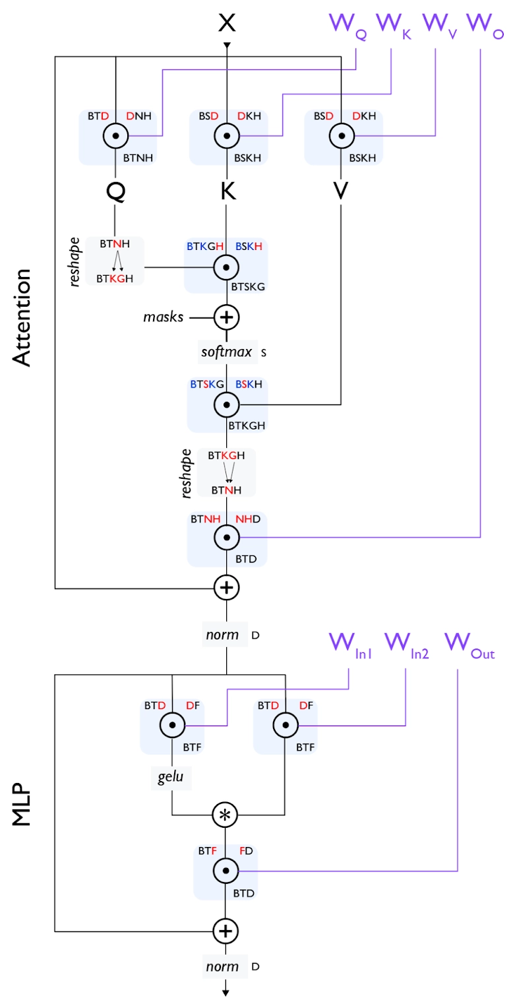
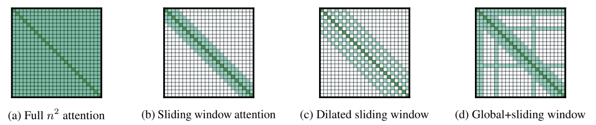

# 第三章　现代 Transformer 语言模型（The modern transformer LM）

> 译自 Alisa's Book of LLMs "The modern transformer LM" 一节；底稿与约定见 [`05-scaling-laws.md`](05-scaling-laws.md) 页眉说明。原图位于 `../snapshots/llm-book/assets/`。

## 架构（Architecture）

| **符号** | **维度** |
|------------|------------------------------------------------|
| B | 批次中的序列条数 |
| L | 层数 |
| T | 序列长度（要生成的词元数） |
| S | 序列长度（已有的上下文） |
| V | 词表大小 |
| D | 隐藏维度 |
| H | 头维度 |
| F | MLP 隐层维度，通常 $F=4D$ |
| N | 查询头数量，$N\cdot H=D$ |
| K | 键/值头数量，GQA 中 $K<N$ |
| G | GQA 的分组大小 $=$ `N // K` |



**词元嵌入（token embedding）**

- 嵌入矩阵 $\mathbf W_e\in\mathbb R^{V\times D}$，初始隐状态 $\mathbf X^{(0)}\in\mathbb R^{B\times S\times D}$

$$\mathbf X^{(0)}=\mathbf {W}_e[\text{tokens}]$$

**逐层循环（对** $\ell\in[0,\dots,L-1]$ **）**

- RMSNorm：把 $\mathbf X^{(\ell)}$ 的每个元素除以它的 RMS（使隐状态的均方根为 1），再乘以可学习的缩放参数 $\gamma$

$$\begin{gather*}\bar{\mathbf X}^{(\ell)}=\frac{\mathbf X^{(\ell)}}{\text{RMS}(\mathbf X^{(\ell)})+\epsilon}\odot\gamma_{\text{attn}}^{(\ell)} \\ \mathrm{RMS}(\mathbf X)=\sqrt{\frac 1D\sum_{i=1}^D x_i^2} \end{gather*}$$

- 每个头用 $W^{(\ell)}_Q\in\mathbb R^{D\times D}$、$W^K\in\mathbb R^{D\times KH}$、$W^{(\ell)}_V\in\mathbb R^{D\times KH}$（其中 $H=D/N$）把 $\mathbf X^{(\ell)}$ 投影到该头的低维子空间

$$\mathbf Q=\bar {\mathbf X}\mathbf W_Q\in\mathbb R^{B\times T\times D},\quad\mathbf K=\bar {\mathbf X}\mathbf W_K\in\mathbb R^{B\times S\times D},\quad\mathbf V=\bar {\mathbf X}\mathbf W_V\in\mathbb R^{B\times S\times D}$$

  - 【可选】QK norm：对查询与键向量再做一次 RMSNorm，控制进入点积的向量幅度
- 变reshape 暴露出头维度：$D\to N\times H$、$K\cdot H\to K\times H$，再把序列长度维（$S$ 或 $T$）和头维（$N$ 或 $K$）转置到前面

$$\begin{gather*}\mathbf Q\in\mathbb R^{B\times T\times D}\to \mathbb R^{B\times N\times T\times H} \\ \mathbf K\in\mathbb R^{B\times S\times (K\cdot H)}\to \mathbb R^{B\times K\times S\times H} \\ \mathbf V\in\mathbb R^{B\times S\times (K\cdot H)}\to \mathbb R^{B\times K\times S\times H} \end{gather*}$$

- GQA 中把 $K$、$V$ 沿头维扩展成 $N$ 份

$$\begin{gather*}\mathbf K\in\mathbb R^{B\times K\times S\times H}\to \mathbb R^{B\times N\times S\times H} \\ \mathbf V\in\mathbb R^{B\times K\times S\times H}\to\mathbb R^{B\times N\times S\times H} \end{gather*}$$

- 对每个位置 $m$ 施加 RoPE：用旋转矩阵 $\mathbf R_m$ 旋转查询向量 $\mathbf q_m\in\mathbb R^H$（或键向量 $\mathbf k_m$）
  - 对第 $i$ 组维度（取 $\mathbf q_m$ 的第 $(2i, 2i+1)$ 个分量），旋转角度 $m\theta_i$，其中 $\theta_i=\Theta^{-\frac{2i}{H}}$
  - 超参数 $\Theta$ 控制基准旋转频率，$H$ 是头维度

$$\mathbf R_m=\begin{bmatrix}\ddots&&&\\&\mathbf R_m^{(i)}&&\\&&\ddots&\end{bmatrix}\in\mathbb R^{H\times H}\quad\text{其中}\quad \mathbf R_m^{(i)}=\begin{bmatrix}\cos(m\theta_i)&-\sin(m\theta_i)\\\sin(m\theta_i)&\cos(m\theta_i)\\\end{bmatrix}$$

$$\mathbf q_m\leftarrow \mathbf R_m \mathbf q_m, \quad\mathbf k_m\leftarrow \mathbf R_m \mathbf k_m,$$

- 计算注意力分数
  - 除以头维度 $H$ 的平方根：不然点积会随 $\sqrt H$ 增大
    - softmax 输入过大 → 分布过尖 → 难被更新推动

$$\mathbf A=\frac{\mathbf Q\mathbf K^\top}{\sqrt H}\in\mathbb R^{B\times N\times T\times S}$$

  - 施加因果掩码：

$$\mathbf A_{ij}\leftarrow \begin{cases} \mathbf A_{ij}&\text{若 }j\leq i\\-\infty&\text{若 }j>i\end{cases}$$

  - 施加 softmax：

$$\mathbf A=\mathrm{softmax}(\mathbf A)=\frac{\exp(\mathbf A_{ij})}{\sum_{k=1}^S \exp(\mathbf A_{ik})}$$

- 由值的加权和得到注意力输出

$$\mathbf O=\mathbf A\mathbf V\in\mathbb R^{B\times N\times T\times H}$$

- 变回原形：

$$\mathbf O\in\mathbb R^{B\times N\times T\times H}\to\mathbb R^{B\times T\times D}$$

- 施加输出投影 $W^{(\ell)}_O\in\mathbb R^{D\times D}$，把不同头的输出混合起来

$$\mathbf O_\text{proj}=\mathbf O\mathbf W_O$$

- 残差连接：

$$\mathbf X^{(\ell)} \leftarrow\mathbf X^{(\ell)}+\mathbf O_\text{proj}$$

**前馈网络（FFN）**

- RMSNorm：

$$\bar{\mathbf X}^{(\ell)}=\frac{\mathbf X^{(\ell)}}{\text{RMS}(\mathbf X^{(\ell)}) + \epsilon}\odot\gamma_{\text{ffn}}^{(\ell)}$$

- 门控投影与上投影【升维】，用 $\mathbf W^{(\ell)}_\text{up}\in\mathbb R^{D\times F}$、$\mathbf W^{(\ell)}_\text{gate}\in\mathbb R^{D\times F}$

$$\begin{gather*}\mathbf U=\bar {\mathbf X}\mathbf W_\text{up} \\ \mathbf G=\bar {\mathbf X}\mathbf W_\text{gate} \end{gather*}$$

- SwiGLU 激活：

$$\begin{gather*}\mathrm{Swish}(\mathbf G)=\mathbf G\odot\sigma(\mathbf G)=\mathbf G\odot\frac{1}{1+e^{-\mathbf G}} \\ \mathbf H=\mathrm{Swish}(\mathbf G)\odot\mathbf U\in\mathbb R^{B\times T\times F} \end{gather*}$$

- 下投影，用 $\mathbf W_\text{down}^{(\ell)}\in\mathbb R^{F\times D}$：

$$\mathbf F=\mathbf H\mathbf W_\text{down}$$

- 残差连接：

$$\mathbf X^{(\ell+1)} =\mathbf X^{(\ell)}+\mathbf F$$

**最终归一化（final layer norm）**

- 收尾 norm：

$$\mathbf X_\text{final}=\frac{\mathbf X^{(L)}}{\text{RMS}(\mathbf X^{(L)}) + \epsilon}\odot\gamma_{\text{final}}$$

**反嵌入（unembedding）**

- 投影回词表维度，用 $\mathbf W_u\in\mathbb R^{D\times V}$：

$$\mathbf Z=\mathbf X_\text{final}\mathbf W_u\in\mathbb R^{B\times T\times V}$$

## 实现要点（Implementation notes）

- 做 softmax 前的注意力分数用 `scores.masked_fill(~mask, -torch.inf)`
  - 约定：`mask` 在**可以**被关注的位置为 `True`
  - `tensor.masked_fill(mask, value)`：`mask` 为 `True` 处填入 `value`
- RoPE
  - 想为每个（位置, 下标）对 $(m,i)$ 缓存 $\cos(m\theta_i)$ 和 $\sin(m\theta_i)$
    - 初始化时一次算好即可

    ```python
    positions = torch.arange(max_seq_len, device=device)  # 形状 (max_seq_len)
    thetas = self.theta ** (-torch.arange(0, d_k, 2, device=device) / d_k)  # 形状 (d_k // 2)
    angles = positions.unsqueeze(-1) * thetas.unsqueeze(0)
    ```

  - 实践中不做一堆 2×2 小矩阵乘法，而是把旋转写成逐元素点乘
    - 把 $\mathbf Q$、$\mathbf K$ 最后一维 $H$ 变形成 $(H/2,2)$，取出偶数位和奇数位：

      ```python
      x_pairs = x.reshape(*x.shape[:-1], -1, 2)
      x_even = x_pairs[..., 0]
      x_odd = x_pairs[..., 1]
      ```

    - 计算旋转后的偶数位和奇数位：

      ```python
      x_out_even = x_even * cos - x_odd * sin
      x_out_odd = x_even * sin + x_odd * cos
      ```

    - 再交错合并：并排 stack 后展平
      - `torch.stack()` 会新增一个维度

      ```python
      torch.stack([x_out_even, x_out_odd], dim=-1).flatten(start_dim=-2)
      ```

- 注意力代码长这样
  - 需要 `.reshape()` 把 `d_model`（$D$）拆成 `num_heads × head_dim`（$N\times H$）
  - 需要 `qkv.unbind()` 拆出查询、键、值【视实现可选】
  - 需要 `.transpose()` 交换 `num_heads` 和 `seq_len` 两维再算注意力
  - 得到 `output` 后要再 `.transpose()`、`.reshape()` 还原形状

  ```python
  batch_size, seq_len, _ = x.shape

  x_norm = self.norm(x)

  qkv = self.qkv_proj(x_norm)  # (batch, seq_len, 3 * d_model)

  qkv = qkv.reshape(batch, seq_len, 3, self.num_heads, self.head_dim)
  q, k, v = qkv.unbind(dim=2)  # (batch, seq_len, num_heads, head_dim)
  q = q.transpose(1, 2)  # (batch, num_heads, seq_len, head_dim)
  k = k.transpose(1, 2)  # (batch, num_heads, seq_len, head_dim)
  v = v.transpose(1, 2)  # (batch, num_heads, seq_len, head_dim)

  causal_mask = torch.tril(torch.ones(seq_len, seq_len)).bool()
  output = scaled_dot_product_attention(q, k, v, mask)  # (batch, num_heads, seq_len, head_dim)

  output = output.transpose(1, 2)  # (batch, seq_len, num_heads, head_dim)
  output = output.reshape(batch, seq_len, d_model)  # (batch, seq_len, d_model)
  output = self.out_proj(output)  # (batch, seq_len, d_model)

  return x + output
  ```

  - 注意力核心：

    ```python
    def scaled_dot_product_attention(q, k, v, mask):
        """
        k, q: (batch_size, ..., seq_len, d_k)
        v: (batch_size, ..., seq_len, d_v)
        返回 o: (batch_size, ..., seq_len, d_v)
        """
        d_k = q.shape[-1]
        scores = (q @ k.transpose(-2, -1)) / math.sqrt(d_k)
        scores = scores.masked_fill(~mask, -torch.inf)
        return softmax(scores, dim=-1) @ v
    ```

## 算账（Accounting）

### 模型参数量

- 嵌入：$(V,D)$
- 注意力 $2D^2+2DKH\approx 4D^2$（标准多头注意力取 $N=K$）
  - $Q$ 是 $(D, D)$
  - $K$ 是 $(D,KH)$
  - $V$ 是 $(D,KH)$
  - $O$ 是 $(D,D)$
- FFN 是 $3DF$
  - 上投影 $(D,F)$
  - 门控投影 $(D,F)$
  - 下投影 $(F,D)$
- 层归一化每层 $2D$（外加最后那次 norm）
  - 注意力前、FFN 前的 norm 各有 $D$ 个参数（$D$ 个维度各一个 $\gamma$）
- 反嵌入：$(V,D)$
- 总计：$2VD+L(4D^2+2D+3DF)\approx 2VD+12LD^2$（取 $F=8D/3$）
  - 即模型总参数量 $2VD+12LD^2$

### 模型激活量

- 注意力激活：$6BSD+BNS^2$
  - 层归一化输入 $(B,S,D)$
  - 层归一化输出 $(B,S,D)$
  - Q、K、V 输出分别是 $(B,S,D)$、$(B,S,KH)$、$(B,S,KH)$
  - 注意力分数 $(B,N,S,S)$
  - 注意力输出 $(B,S,D)$
- FFN 激活：$2BSD+2BSF\approx 8BSD$（取 $F=8D/3$）
  - 层归一化输入 $(B,S,D)$
  - 门控/上投影输出各 $(B,S,F)$
  - 下投影输出 $(B,S,D)$
- 每层激活合计 $14BSD+BNS^2$

### 前向传播 FLOPs

- 假设预填充阶段（$S=T$）
- 注意力每层 $8BSD^2+4BS^2D$
  - $Q$ 投影 $(B,S,D)\times(D,D)$ → $2BSD^2$ FLOPs
  - $K$ 投影 $(B,S,D)\times(D,KH)$ → $2BSDKH\approx 2BSD^2$（取 $K=N$）
  - $V$ 投影 $(B,S,D)\times(D,KH)$ → $2BSDKH\approx 2BSD^2$（取 $K=N$）
  - $QK^\top$：$(B,N,S,H)\times(B,N,H,S)$ → $2BNS^2H=2BS^2D$（因 $D=NH$）
  - $AV$：$(B,N,S,S)\times(B,N,S,H)$ → $2BS^2D$
  - $O$ 投影 $(B,S,D)\times(D,D)$ → $2BSD^2$ FLOPs
- FFN 每层 $6BSDF\approx16BSD^2$（取 $F=8D/3$）
  - 上投影 $(B,S,D)\times(D,F)$ → $2BSDF$
  - 门控投影 $(B,S,D)\times(D,F)$ → $2BSDF$
  - 下投影 $(B,S,F)\times(F,D)$ → $2BSDF$
- 每层合计：$8BSD^2+4BS^2D+16BSD^2=2BSD(12D+2S)$
- 反嵌入层 $2BSDV$
  - $(B,S,D)\times(D,V)$ → $2BSDV$
- 完整前向传播 $2LBSD(12D+2S)+2BSDV\approx 2BSD(12LD+2LS+V)$

### 反向传播 FLOPs

- 一般按前向的 2 倍估算
  - 要分别算对参数和对输入的梯度，各需一次矩阵乘法
    - 对输入的梯度 $\partial L/\partial X$ 正是传给上一层的上游梯度

### 推理显存

- 推理总显存 = 模型权重 + KV 缓存 + 峰值激活
  - 参数量：$2VD+12LD^2$

    ```python
    num_params = sum(p.numel() for p in model.parameters())
    ```

  - KV 缓存大小：$B\cdot S\cdot(KH)\cdot L\cdot 2$
    - $B$ = 批大小
    - $S$ = 序列长度
    - $K$ = KV 头数
    - $H$ = 头维度
    - $L$ = 层数
    - 乘 2 是因为 K 和 V 各一份
  - 激活：预填充 $O(BNS^2+BSF)$，解码 $O(BNS+BF)$
    - `torch.inference_mode()` 会立即释放显存，所以只需考虑单层的峰值
    - 输入在预填充时是 $B\times S\times D$，解码时是 $B\times T\times D$
    - 有 FlashAttention 就不会物化 $S\times S$ 矩阵 → 注意力激活降为 $O(S)$
    - 峰值激活构成：
      - $B\cdot S\cdot D$ = 层的输入
      - $B\cdot S\cdot 3\cdot D$ = K、Q、V 向量
      - $B\cdot N\cdot S^2$ = 注意力矩阵（没有 FlashAttention 时）
        - 批里每条序列、每个查询头各一张 $S\times S$
      - $B\cdot S\cdot F$ = FFN 中间结果
    - 无 FlashAttention 时激活随序列长度 $S$ 二次增长，有则线性增长
- 批小、序列短时：权重占大头
- 预填充阶段：
  - 序列很长（$S$ 大）时：激活中的 $S^2$ 注意力项占大头
- 批很大（$B$ 大）时：KV 缓存和激活都涨

### 训练显存

- 训练总显存 = 模型权重 + 优化器状态 + 梯度 + 激活
  - $P$ 个参数
    - FP32 主权重【全精度或混合精度】→ $4P$
    - 前向传播用的 BF16 临时副本【混合精度】→ $2P$
  - 优化器状态 $2P$（一阶矩 + 二阶矩）
    - Adam 状态 FP32【混合精度】→ $8P$
  - 梯度 $P$
    - FP32 → $4P$
      - 即使混合精度下梯度用 BF16 计算，累加仍在 FP32
  - 激活
    - 常常是最大头：取决于 $B$、$S$、$D$、$L$
    - 每层 $14BSD+BNS^2$（无 FlashAttention）
      - 有 FlashAttention 时第二项降为 $BNS$，激活显存随 $BS$（词元总数）增长
    - 反向传播算梯度时需要它们；可用梯度检查点压缩

## 注意力（Attention）

- 标准注意力是 $O(n^2)$
- （若用局部注意力）KV 缓存与序列长度无关
  - 词元一出窗口就可以直接丢掉
- **滑动窗口**：每个词元只关注最近 $W$ 个词元，计算量从 $O(n^2)$ 降到 $O(nW)$
  - $n$ 个词元各做 $O(W)$ 的功（对 $W$ 个键/值做注意力）
- **稀疏注意力**
- 把局部注意力和全局注意力交错排布



## RMSNorm

- 归一化通过阻止梯度爆炸/消失来稳定训练
  - 但只做统一缩放太死板：不同特征可能需要不同幅度
  - $\gamma$ 兼得两头：归一化的稳定性 + 逐维度的幅度自由
- $\gamma\in\mathbb R^D$ 是可学习的逐维缩放
  - 归一化这一步强制隐状态 RMS 为 1，把学到的尺度信息全抹掉了
- $\gamma$ 把逐特征的幅度控制权还给网络
  - $\gamma_i>1$ → 放大第 $i$ 维
  - $\gamma_i<1$ → 压低第 $i$ 维
  - $\gamma_i\approx0$ → 关掉第 $i$ 维

## SwiGLU FFN

- $\mathbf G$ 和 $\mathbf U$ 都在贡献内容
  - $\mathbf U$ 提供一份学出来的表示，$\mathbf G$ 提供另一份（按自身置信度自门控）

## RoPE

- RoPE 只旋转查询和键向量，不动值向量
  - 位置信息只需要影响"谁关注谁"，不需要影响"传过去什么信息"
- 对位置 $m$ 的查询 $\mathbf q$ 与位置 $n$ 的键 $\mathbf k$，希望点积 $\mathbf q\cdot\mathbf k$ 只依赖**相对**位置 $m-n$
  - 想找 $f$，使得点积 $\langle f(\mathbf q,m),f(\mathbf k,n)\rangle$ 是一个只以相对形式编码信息的函数 $g$，例如

$$\langle f(\mathbf q,m),f(\mathbf k, n)\rangle=g(\mathbf q,\mathbf k,n-m)$$

  - RoPE 就是满足条件的一类解：

$$\begin{gather*}f(\mathbf x,m)=R_{m\theta}\mathbf x \\ g(\mathbf q,\mathbf k,n-m)=\mathbf q^\top R_{(n-m)\theta}\mathbf k \end{gather*}$$

  - 证明

$$\begin{align*}\langle R_{m\theta}\mathbf q,R_{n\theta}\mathbf k\rangle=(R_{m\theta}\mathbf q)^\top R_{n\theta}\mathbf k \\ &=\mathbf q^\top R_{m\theta}^\top R_{n\theta}\mathbf k \\ &=\mathbf q^\top R_{-m\theta}R_{n\theta}\mathbf k\quad\text{因为 }R_\alpha^\top=R_{-\alpha} \\ &=\mathbf q^\top R_{(n-m)\theta}\mathbf k\quad\text{因为 } R_\alpha R_\beta=R_{\alpha+\beta} \end{align*}$$

- 点积随距离增大而衰减
- 二维向量 $\mathbf x=[x_1,x_2]$ 绕角度 $\theta$ 旋转：

$$R_\theta=\begin{bmatrix}\cos\theta&-\sin\theta\\\sin\theta&\cos\theta\end{bmatrix}$$

  - 对位置 $m$、头维度下标 $i$，旋转 $m\theta_i$：

$$R_{m\theta}\mathbf x=\begin{bmatrix}x_1\cos(m\theta_i)-x_2\sin(m\theta_i)\\x_2\sin(m\theta_i)+x_2\cos(m\theta_i)\\\end{bmatrix}$$

〔转写注：第二行按旋转矩阵应为 $x_2\cos(m\theta_i)+x_1\sin(m\theta_i)$，原图写作 $x_2\sin+x_2\cos$，疑为笔误，照录。〕

- 对 $H$ 维嵌入：均分成 $H/2$ 对，每对用不同频率独立旋转
  - $\Theta$ 是 RoPE 唯一的超参数，通常取 10,000（HF 里叫 `rotary_base`）
    - 它决定模型原生能区分的最长距离
    - 旋转一整圈发生在 $m\theta_i=2\pi$ ⇒ $m=\frac{2\pi}{\theta_i}$〔转写注：原图写作 $m=\frac{d\pi}{\theta_i}$，且下文 $m=d\pi\Theta$ 同式，按旋转定义应为 $2\pi/\theta_i$，照录〕
      - 最慢（最小）的 $\theta_i$ 是 $\Theta^{-1}$ → $m=2\pi\Theta$
      - 所以最慢的一组维度约在 $2\pi\Theta$ 个位置内转完一整圈
  - 每组维度 $i$ 的频率：

$$\theta_i=\Theta^{-2i/H}$$

  - 指数间隔（与原始 Transformer 的正弦位置编码同一设计选择）
      - 频率按对数均匀铺开 → 有效覆盖各种尺度
    - 低频组（$i$ 大 → $\theta_i$ 小）转得慢 → 相邻位置几乎不变 → 编码长程信息
    - 高频组（$i$ 小 → $\theta_i$ 大）转得快 → 相邻位置差别很大 → 分辨近处细节
- 完整旋转矩阵（单个位置）是分块对角的，每个 $2\times2$ 块管一组维度

$$\mathbf R_m=\begin{bmatrix}\ddots&&&\\&\mathbf R_m^{(i)}&&\\&&\ddots&\end{bmatrix}$$

- 也可以用复数改写
  - 把每组 $[x_{2i},x_{2i+1}]$ 看成复数 $z=x_{2i}+ix_{2i+1}$
  - 旋转角度 $\theta$ 等价于乘以 $e^{i\theta}$
    - 欧拉公式：$e^{i\theta}=\cos\theta+i\sin\theta$

$$\begin{align*}z e^{i\theta}=(a+bi)(\cos\theta+i\sin\theta)\quad\text{欧拉公式} \\ &=(a\cos\theta-b\sin\theta)+i(a\sin\theta+b\cos\theta) \end{align*}$$

  - 这与在复平面上施加旋转矩阵等价：

$$\begin{bmatrix}\cos\theta&-\sin\theta\\\sin\theta&\cos\theta\end{bmatrix}\begin{bmatrix}a\\b\end{bmatrix}$$

- 实践中不构造完整旋转矩阵，而是做逐元素乘法：

$$\begin{bmatrix} x_1\\x_2\end{bmatrix}\odot\begin{bmatrix}\cos(m\theta)\\\cos(m\theta)\end{bmatrix}+\begin{bmatrix} -x_2\\x_1\end{bmatrix}\odot\begin{bmatrix}\sin(m\theta)\\\sin(m\theta)\end{bmatrix}$$
