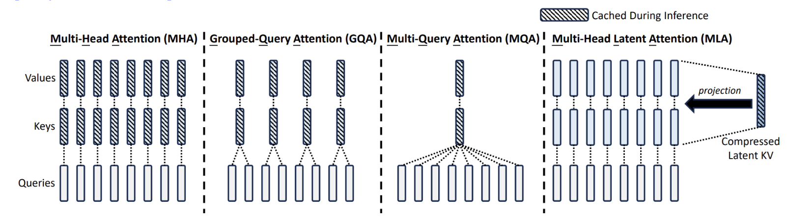

# 第四章　推理（Inference）

> 译自 Alisa's Book of LLMs "Inference" 一节；底稿与约定见 [`05-scaling-laws.md`](05-scaling-laws.md) 页眉说明。原图位于 `../snapshots/llm-book/assets/`。

- **延迟**（latency）是完成单个请求所需的时间，单位秒
- **吞吐**（throughput）是单位时间能处理多少词元（或请求），单位 tokens/秒

## 批处理与拼接（Batching & packing）

- **传统批处理**：攒够 $N$ 个请求一起做，等全部做完再收下一批
  - 如果一条序列生成 500 个词元、另一条只要 10 个，短的那条就得干等着
- **连续批处理**（continuous batching）：一条序列一结束，立刻把新请求补进它的位置，不等整批
  - 批的位置始终是满的
- **选择性批处理**（selective batching）：把处于预填充（prefill）阶段和生成（decode）阶段的序列巧妙地混在一批里
  - 思路：预填充是计算密集型，解码是访存密集型，两者互补
- **序列拼接**（sequence packing）：把多条样本首尾相接拼到最大序列长度，用注意力掩码防止互相"串味"
- **词元预算批处理**（token-budget batching）：按"批内补齐到本批最长长度后的总词元数不超过预算"来组批
  - 常见于微调
  - 道理在于：GPU 显存由 `batch_size × sequence_length` 决定

## 投机解码（Speculative decoding）

- **投机解码**利用的是"预填充比逐词元生成快得多"这一事实
- 先用草稿模型 $q$ 一口气生成 $K$ 个词元
- 再用目标模型 $p$ 一次性给这些词元打分
  - 每个草稿词元 $x$ 以概率

$$\min\left(1,\frac{p(x)}{q(x)}\right)$$

    被接受
    - 若 $p(x)>q(x)$，一定接受

  - 若被拒绝，从调整后的分布 $\max(0,\,p(x)-q(x))$ 归一化后重新采样
    - 从第一个被拒绝的词元开始
  - 总有一个词元直接从"老师"模型采样得到——给草稿词元打分时，下一步的 logits 是"顺带免费"拿到的

- 发出词元 $x$ 的概率 = P(草稿给出 $x$)·P(接受 $x$) + P(采到的词元被拒)·P(重采样出 $x$)
  - 情形 1（第一项）：$x$ 来自草稿并被接受

$$q(x)\cdot\min\left(1,\frac{p(x)}{q(x)}\right)=\min(q(x),p(x))$$

  - 情形 2（第二项）：$x$ 是拒绝后重采样选出的
    - "草稿给出 $x'$ 且被拒"的概率：
      - 若 $p(x')>q(x')$ 则为 0
      - 否则

$$q(x')\cdot\left(1-\frac{p(x')}{q(x')}\right)=q(x')-p(x')$$

  - 于是拒绝的总概率为

$$P(\text{拒绝})=\sum_{x'}\max(0,q(x')-p(x'))=\sum_{x'}\max(0,p(x')-q(x'))$$

  - 第二个等号成立，因为 $p$ 与 $q$ 都是和为 1 的分布

    - 拒绝时，我们从

$$\frac{\max(0,p(x)-q(x))}{\sum_{x'}\max(0,p(x')-q(x'))}$$

    中采样

    - 所以拒绝后拿到 $x$ 的概率是

$$\sum_{x'}\max(0,p(x')-q(x'))\cdot \frac{\max(0,p(x)-q(x))}{\sum_{x'}\max(0,p(x')-q(x'))}=\max(0,p(x)-q(x))$$

  - 两种情形相加：

$$\min(q(x),p(x))+\max(0,p(x)-q(x))=p(x)$$

  ——输出的分布与目标模型 $p$ 完全一致，投机解码不改变生成质量。

## KV 缓存（KV cache）

- 带缓存的单词元前向传播
  - 缓存形状 `(batch, num_heads, max_seq_len, head_dim)`
  - 实践中把缓存存在自注意力模块内部（`self.kv_cache`）

  ```python
  # 按 max_seq_len 预分配缓存
  kv_cache = [
      {
          'k': torch.zeros(batch, num_heads, max_seq_len, head_dim, device='cuda', dtype=torch.float16),
          'v': torch.zeros(batch, num_heads, max_seq_len, head_dim, device='cuda', dtype=torch.float16),
      }
      for _ in range(num_layers)
  ]

  # 注意力计算时用 cache[:, :, :position+1, :] 作为键/值

  def forward_with_cache(model, new_token, kv_cache, position):
      """只处理新词元，复用之前位置缓存的 K、V，而不是整段重算。"""
      # 只对新词元做嵌入
      x = model.embed(new_token)  # (batch, 1, d_model)

      for layer_idx, layer in enumerate(model.layers):
          q, k, v = layer.qkv_proj(x).chunk(3, dim=-1)

          # 写入缓存
          kv_cache[layer_idx]['k'][:, :, position, :] = k.squeeze(2)
          kv_cache[layer_idx]['v'][:, :, position, :] = v.squeeze(2)

          # 对所有已缓存的位置做注意力
          k_full = kv_cache[layer_idx]['k'][:, :, :position+1, :]
          v_full = kv_cache[layer_idx]['v'][:, :, :position+1, :]

          x = attention(q, k_full, v_full)
          x = layer.ffn(x)

      return model.lm_head(x)
  ```

### 缩小 KV 缓存

**降低 KV 缓存的维度**

- 标准**多头注意力**（MHA）中，KV 缓存随 `num_layers × num_heads × seq_len × head_dim × 2（K 和 V）`增长
- **多查询注意力**（multi-query attention, MQA）：所有头共享同一份 K 和 V，只有 Q 各自保留
  - KV 缓存直接缩小 `num_heads` 倍
  - 推理显著更快、更省内存
- **分组查询注意力**（group-query attention, GQA）：头分组，组内共享 K 和 V
  - 是 MHA 与 MQA 的折中
- MQA 与 GQA 让头之间共享 KV，每个头的表达能力会有所损失
- **多头潜在注意力**（multi-head latent attention, MLA）由 DeepSeek v2 提出
  - 缓存里不再存形状 `(seq_len, num_heads × head_dim)` 的键值，而存一个更小的潜在向量 `(seq_len, latent_dim)`
  - 每个解码步再把潜在 KV 投影回完整尺寸
- MLA 每头仍有各自的 KV，只是把它们压缩进一个共享的潜在空间
  - 推理时多了一点计算（潜在 → KV 的投影）
  - MLA 与 RoPE 不兼容



- **跨层注意力**（cross-layer attention）：层与层之间共享 KV

**局部注意力**

- 标准注意力是 $O(n^2)$；改用局部注意力后，KV 缓存与序列长度无关
  - 词元一旦滑出窗口就可以直接丢掉

## 采样策略（Sampling strategies）

```python
def sample(logits, temperature=1.0, top_k=None, top_p=None):
    logits = logits / temperature  # 温度：>1 更随机，<1 更保守

    if top_k is not None:
        # 只保留概率最高的 top_k 个词元
        values, indices = torch.topk(logits, top_k)
        logits = torch.full_like(logits, float('-inf'))
        logits.scatter_(-1, indices, values)

    if top_p is not None:
        # 核采样：按概率从大到小累加，截断累计概率超过 top_p 的部分
        sorted_logits, sorted_indices = torch.sort(logits, descending=True)
        cumulative_probs = torch.cumsum(F.softmax(sorted_logits, dim=-1), dim=-1)

        # 移除累计概率超过阈值的词元
        sorted_mask = cumulative_probs > top_p
        sorted_mask[..., 1:] = sorted_mask[..., :-1].clone()
        sorted_mask[..., 0] = False

        indices_to_remove = sorted_mask.scatter(-1, sorted_indices, sorted_mask)
        logits = logits.masked_fill(indices_to_remove, float('-inf'))

    probs = F.softmax(logits, dim=-1)
    return torch.multinomial(probs, num_samples=1)
```

## Flash Attention

- 标准注意力
  - 内存问题出在 `attn_weights` 的形状是 `(batch, num_heads, seq_len, seq_len)`
    - `seq_len` 取 8192、32 个头、FP16：$8192^2\times32\times2$ 字节 ≈ 4GB

  ```python
  import torch
  import torch.nn.functional as F
  import math

  def standard_attention(q, k, v):
      # q、k、v 形状均为 (batch, num_heads, seq_len, head_dim)
      scale = math.sqrt(q.size(-1))

      # 把完整的 N×N 注意力矩阵真正算出来（materialize）
      attn_weights = torch.matmul(q, k.transpose(-2, -1)) / scale  # (batch, num_heads, seq_len, seq_len)
      attn_weights = F.softmax(attn_weights, dim=-1)

      output = torch.matmul(attn_weights, v)  # (batch, num_heads, seq_len, head_dim)
      return output
  ```

  - 标准注意力为何受限于内存带宽：$N\times N$ 注意力矩阵要写入 HBM、读回来（算 softmax）、再写回、再读回（真正使用）
- **Flash Attention** 按分块计算注意力，借助"在线 softmax"技巧把中间结果全部留在高速的 SRAM 里，不把完整注意力矩阵写回 GPU 主存
  - 注意力的激活内存从 $O(n^2)$ 降到 $O(n)$
  - 更快是因为不再被内存带宽卡住脖子
  - 推理时可用 `model.to_bettertransformer()`，或在 `from_pretrained()` 里传 `attn_implementation="flash_attention_2"` 启用

  ```python
  def flash_attention(q, k, v):
      # 输入形状不变：(batch, num_heads, seq_len, head_dim)
      # PyTorch 自动选最优后端（Flash Attention、memory-efficient 或 math）
      output = F.scaled_dot_product_attention(q, k, v, is_causal=True)
      return output
  ```

- FlashAttention 从不物化完整的 $N\times N$ 矩阵，而是按能塞进 SRAM 的小块分片计算
- 概念上：
  1. 读入一块 $Q$（比如 64 行）
  2. 读入一块 K 和 V（比如 64 列）
  3. 这块的注意力分数、softmax、乘 V——全部在 SRAM 里完成
  4. 只把最终输出写回 HBM
  5. 其余分块重复以上步骤
- 每个 (batch, head) 组合完全独立，所以有 `batch × num_heads` 个并行工人，各自处理 `m × head_dim` 的 Q/K/V 分片（`m` 是分块大小）
- *Flash Attention 是精确算法，不是近似*

- 用法

  - `is_causal=True`（因果掩码）直接融合进核函数，高效实现，不需要物化掩码矩阵

  ```python
  def flash_attention(q, k, v):
      # 输入形状不变：(batch, num_heads, seq_len, head_dim)
      # PyTorch 自动选最优后端（Flash Attention、memory-efficient 或 math）
      output = F.scaled_dot_product_attention(q, k, v, is_causal=True)
      return output
  ```
