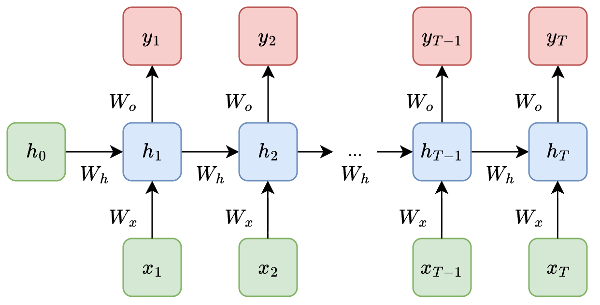

# 第七章　其他架构（Other architectures）

> 译自 Alisa's Book of LLMs "Other architectures" 一节；底稿与约定见 [`05-scaling-laws.md`](05-scaling-laws.md) 页眉说明。原图位于 `../snapshots/llm-book/assets/`。

## 循环神经网络（RNNs）

### 朴素 RNN

- 每一步 $t$：处理输入 $x\in\mathbb R^D$ 和上一步隐状态 $h_{t-1}\in\mathbb R^H$，产出新的隐状态 $h_t$（$D$ 是输入维度，$H$ 是隐状态维度）
  - 权重矩阵 $W_x\in\mathbb R^{H\times D}$、$W_h\in\mathbb R^{H\times H}$

$$\begin{gather*}h_t=\tanh(W_{x}x_t+W_{h}h_{t-1}+b) \\ y_t=W_\text{out} h_t+b_\text{out} \end{gather*}$$

  - 权重在时间步之间共享
- 梯度消失的原因
  - 记 $z_t=W_xx_t+W_hh_{t-1}+b$

$$\frac{\partial h_t}{\partial h_{t-1}}=\mathrm{diag}(\tanh'(z_t))\, W_h$$

  - $\tanh^\prime$ 只会把梯度往小里缩，因为 $\tanh^\prime\in(0,1]$
  - 反复乘 $W$ 的结果要么是梯度消失，要么是梯度爆炸〔原文 "exploring" 为 "exploding" 之误〕

### LSTM

- LSTM 在普通隐状态之外维护一个**细胞状态** $c_t$，并配遗忘门、输入门、输出门三种门
  - 每步的输入：上一隐状态 $h_{t-1}$、上一细胞状态 $c_{t-1}$、当前输入 $x_t$
  - **遗忘门**：从细胞状态里擦掉什么

$$f_t=\sigma(W_f\cdot [h_{t-1}, x_t]+b_f)$$

  - **输入门**：写入什么新信息

$$i_t=\sigma(W_i\cdot[h_{t-1},x_t]+b_i)$$

  - 候选细胞状态

$$\tilde c_t=\tanh(W_c\cdot[h_{t-1},x_t]+b_c)$$

  - 细胞状态更新：从旧细胞状态 $c_{t-1}$ 忘掉一部分，再加入新候选 $\tilde c_t$ 的一部分

$$c_t=f_t\odot c_{t-1}+i_t\odot\tilde c_t$$

  - **输出门**：允许向外暴露什么作为新隐状态

$$o_t=\sigma(W_o\cdot[h_{t-1},x_t]+b_o)$$

  - 新隐状态

$$h_t=o_t\odot\tanh(c_t)$$

- 只要 $f_t$ 保持在 1 附近，梯度就能往回穿过许多时间步而不消失
- 细胞状态是"仓库"，隐状态是"工作输出"
  - 细胞状态沿高速公路直通下游，沿途只有逐元素乘法与加法，没有矩阵乘法、没有非线性
  - 信息的存取只能通过门控进行
- 隐状态 $h_t=o_t\cdot \tanh(c_t)$ 是细胞状态经过滤的一份视图
  - 它身兼两职：
    - 细胞对外输出的内容
    - 细胞下一步对自己的"查询"——因为 $t+1$ 步的门是从 $h_t$（而不是 $c_t$）算出来的
- 把细胞状态和隐状态**分开**，正是 LSTM 管用的关键
  - 朴素 RNN 是拿一个向量同时当长期记忆和当前输出，两头都干不好
- GRU 是简化版，只剩重置门和更新门两扇门

### 与 Transformer 对比

- （RNN 中）来自*遥远*时间步的梯度无法再影响*更早*时间步的加工
- RNN 对 Transformer：
  - 注意力在任意两个词元之间都提供直接的 / $O(1)$ 通路，与距离无关
    - 每个词元直接看所有其他词元
    - 而在 RNN 里，词元 1 的信息要在所有中间隐状态里一路存活，才能到达词元 100
    - 这对长距离依赖非常关键
  - 注意力一次性算出所有两两关系

## 状态空间模型（State space models）

- SSM 的基本方程
  - $u_k$ 是一维输入信号
  - $x_k$ 是 $N$ 维隐状态

$$x_k=A x_{k-1}+B u_k$$

- SSM 训练时是 $O(n)$ 且可并行，推理时是 $O(1)$ 状态、顺序推进
  - 对照：Transformer 可并行但注意力是 $O(n^2)$；RNN 是 $O(n)$ 但必须串行
- Mamba 把 $B$、$C$、$\Delta$ 变成输入的函数

$$\begin{gather*}B_k=f_B(u_k) \\ C_k=f_C(u_k) \\ \Delta_k=f_\Delta(u_k) \end{gather*}$$

  - 通过 $B$ 选择性地写入信息
  - 通过 $C$ 选择性地读取状态
  - 通过 $\Delta$ 控制时间尺度
