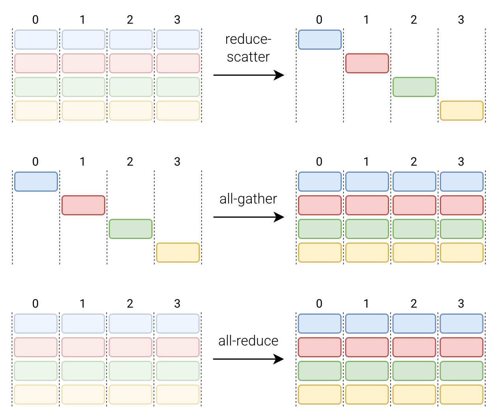
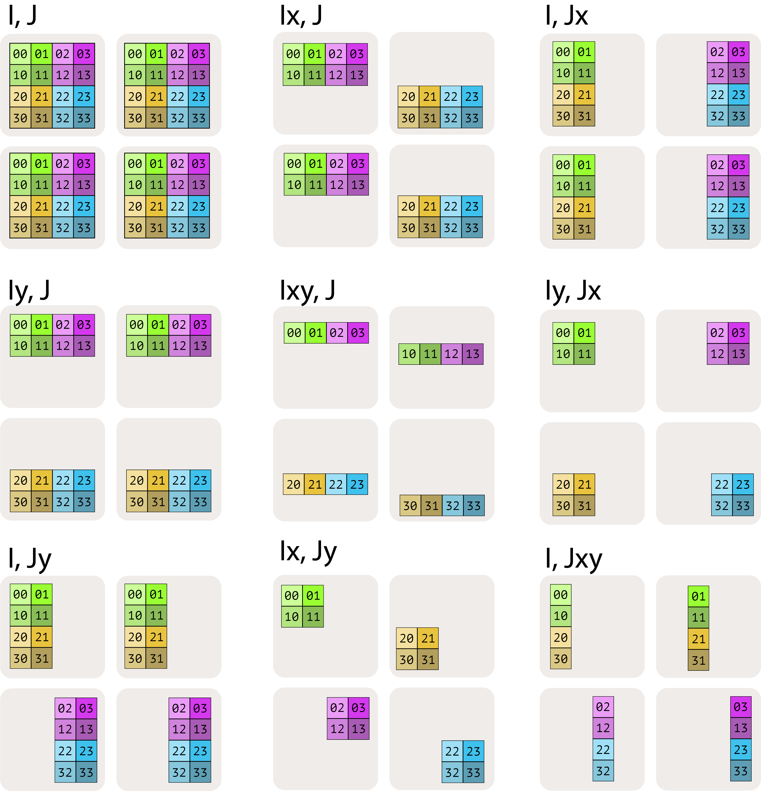
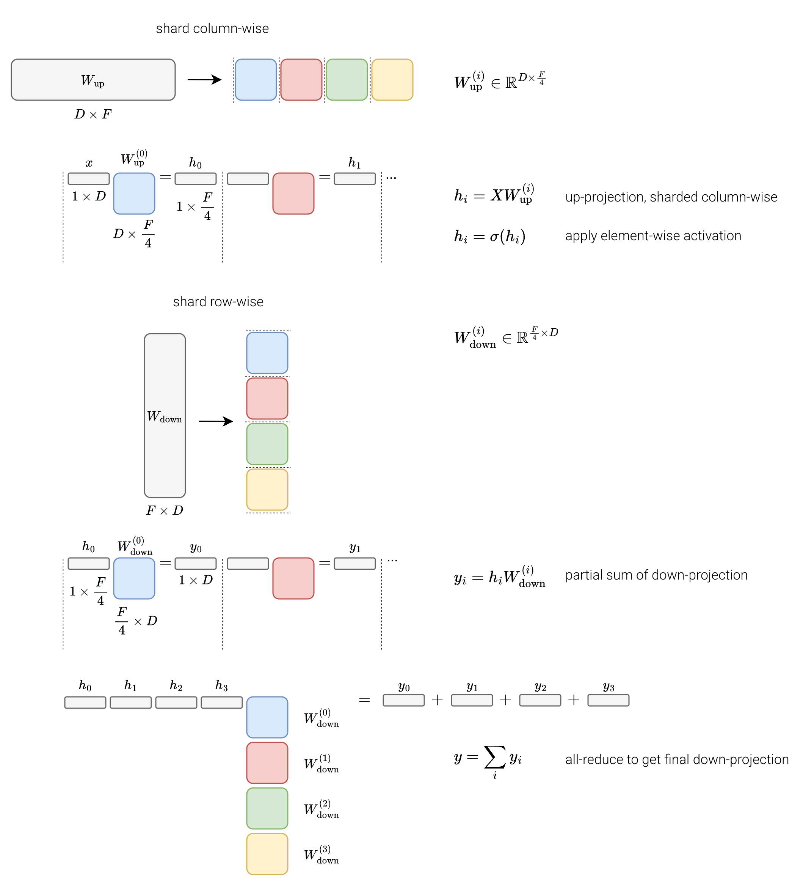

# 第十章　并行（Parallelism）

> 译自 Alisa's Book of LLMs "Parallelism" 一节；底稿与约定见 [`05-scaling-laws.md`](05-scaling-laws.md) 页眉说明。原图位于 `../snapshots/llm-book/assets/`。

- **数据并行**把数据批次分到各设备；**模型并行**把单次前向传播的计算分到各设备
  - FSDP 把参数分片到各 rank（进程编号）以省显存，但每个 rank 仍然计算完整的前向传播——只是在各参数即将用到之前做一次 all-gather 收集

- 数据并行的局限
  - 要求 $M<B$（设备数小于批大小），这未必可取，因为 $B$ 本来就不该超过"临界批大小"
  - 模型仍可能放不进单卡（即使 ZeRO 第 3 阶段也不减少每卡的激活显存）
- **强扩展**（strong scaling）：增加训练芯片数量，吞吐（FLOPs/秒）成比例上升
- 一句话总结：DP 扩展吞吐，TP/PP 扩展模型显存，SP 扩展激活显存
- **5D 并行**
  - **数据并行**（data parallelism, DP）：把数据批次分到各设备
  - **张量并行**（tensor parallelism, TP）：把模型的不同部分分到各设备
  - **流水并行**（pipeline parallelism, PP）〔原文误标 (TP)〕：把各层/权重矩阵切开分到各设备
  - **序列并行**（sequence parallelism, SP）：把输入序列长度分到各设备
  - **专家并行**（expert parallelism, EP）：把 MoE 模型的不同专家分到各设备

## 背景：核心集合通信操作

- **broadcast**（一对全，相同数据）：一块 GPU 持有数据，把同样的副本发给其他所有 GPU
- **all-gather**（全对全）：每块 GPU 各持一片数据，最后每块 GPU 都拿到完整集合
  - 作用是**去掉**某个轴上的分片

$$\mathrm{AllGather}_Y:\mathbf A[I,J_Y]\rightarrow \mathbf A[I,J]$$

- **reduce-scatter**：每块 GPU 都持有未归约的数据，先做归约（如求和），结果再分片到各 GPU
  - 和 all-gather 很像，区别是不保留各自的分片，而是把它们加起来
  - 作用是**加上**某个轴上的分片

$$\mathrm{ReduceScatter}_{Y,J}:\mathbf A[I,J]\{U_Y\}\rightarrow \mathbf A[I,J_Y]$$

- **all-reduce**：每块 GPU 都持有未归约的数据，归约后每块 GPU 都拿到最终结果

$$\mathrm{AllReduce}_Y\mathbf A[I,J]\{U_Y\}\rightarrow A[I, J]$$



- 环形 all-reduce = reduce-scatter + all-gather（每个进程只和左右邻居通信）[（动画演示）](https://www.youtube.com/watch?v=CQ-cOykh0sY)
  - 开始时每块 GPU 都拿着未归约的数据
  - reduce-scatter 段：通过归约合并数据，每块 GPU 得到一个归约后的子集——只做算术，不做多余复制
  - all-gather 段：每块 GPU 拿到全部归约子集——只做复制，不做算术
- 对 all-gather、reduce-scatter、all-reduce 而言，通信时间只取决于数组大小和带宽，*与分片数量无关*！
- reduce-scatter 和 all-gather 互为对方操作的反向传播
  - 前向用 all-gather → 反向用 reduce-scatter
    - all-gather 把同一段广播给所有设备，各设备拿它去做不同的下游计算
    - 反向传播中，上游梯度在"分叉出去"的分支处要相加（若 $x=a+b$，则 $\partial f/\partial x=\partial f/\partial a\cdot\partial a/\partial x+\partial f/\partial b\cdot\partial b/\partial x$）〔原文两写成了同一项，此处按正确形式给出〕
    - 这正是 reduce-scatter：把所有上游梯度加回到数据出发的设备
    - 前向"一分为多" → 反向"多路求和"
  - 前向用 reduce-scatter → 反向用 all-gather
    - reduce-scatter 把很多输入加成一个分片
    - 反向传播里，求和节点会把上游梯度复制给每个加项
    - 这正是 all-gather：把每个分片的梯度广播回它的贡献者
    - 前向"求和" → 反向"一分为多"
- 由此还得出：all-reduce 的反向传播仍是 all-reduce！

**分片记号**

- 设备网格有轴 $(X, Y)$，矩阵 $A$ 有轴 $(I, J)$
- $I_X$：把 $A$ 的行切开放到设备网格的列轴上
- $I_Y$：把 $A$ 的行切开放到设备网格的行轴上
- $J_Y$：把 $A$ 的列切开放到设备网格的行轴上
- $J_X$：把 $A$ 的列切开放到设备网格的列轴上
- $I_{XY}$：把 $A$ 的行切开放到展平后的 $XY$ 网格的所有设备上
- $I$：$A$ 的行不切分
- 某个网格轴不出现在记号里，就意味着数据沿该轴**复制**
  - 例如 $Y$ 不出现：每一列上的数据相同



- 矩阵乘法的好性质：把矩阵按分块写出来，乘积就能用"分块的矩阵乘法"表示
- 矩阵乘法的四种情形
  - 情形 1：两个矩阵的被缩并轴（contracting dim，即相加消掉的那个轴）都没有分片

$$\mathbf A[I_X,J]\cdot \mathbf B[J, K_Y]\rightarrow \mathbf C[I_X, K_Y]$$

    

    - 不需要任何通信
    - 本地做分块矩阵乘法即可
    - 输出的分片方式正好就是想要的

  - 情形 2：$A$ 或 $B$ 有一方的被缩并轴分了片

$$\mathbf A[I,J_X]\cdot \mathbf B[J, K]\rightarrow \mathbf C[I,K]$$

  - 先 all-gather 把 $A$ 的分片补齐成整份，再与 $B$ 相乘

$$\begin{gather*}\mathrm{AllGather}_X[I, J_X]\rightarrow \mathbf A[I, J] \\ \mathbf A[I,J]\cdot\mathbf B[J, K]\rightarrow\mathbf C[I,K] \end{gather*}$$

  - 情形 3：$A$ 和 $B$ 的被缩并轴都分了片

$$\mathbf A[I,J_X]\cdot \mathbf B[J_X, K]\rightarrow\mathbf C[I,K]$$

  - 乘法可以做，但每台设备算出的只是完整乘积的**部分和**
      - 沿 $X$ 轴的每台设备各持一份不同的部分和
      - 记号 $C[I,K]\{U_X\}$ 表示"沿 $X$ 网格轴尚未归约"
    - 沿 $X$ 轴做一次 all-reduce 完成最后的求和

$$\mathrm{AllReduce}_X C[I,K]\{U_X\}\rightarrow C[I,K]$$

  - 结果每台设备拿到同样的完整和

  - 情形 4：$A$ 和 $B$ 的非缩并轴沿同一网格轴分片（输出天然对齐，无需通信）

## 数据并行（Data parallelism）

**朴素数据并行（DDP）**

- 把大小为 $B$ 的批次中的样本分到 $M$ 台设备，各自训练再交换梯度
- 步骤
  1. 在本地微批次上跑前向传播
  2. 计算全部参数的梯度
  3. 跨 GPU **all-reduce** 梯度，让每块 GPU 都拿到平均后的梯度
  4. 每块 GPU 各自更新全部参数
     - 这一步每台设备做的事完全相同
- 模型能放进单卡时，永远应该优先用它
- 通信只发生在反向传播
- 允许把批大小随设备数任意增大

**ZeRO 第 1 阶段：优化器状态分片**

- 每台设备只保留 $1/M$ 的 Adam 状态向量，也只更新自己负责的那部分参数
- 步骤
  1. 在本地微批次上跑前向传播
  2. 计算全部参数的梯度
  3. **reduce-scatter** 梯度：每台 GPU 只保留自己那份参数的归约后梯度
  4. 每台 GPU 用自己的优化器状态更新自己那份参数
  5. **all-gather** 更新后的参数
- 一次 all-reduce 的通信代价恰好等于 reduce-scatter + all-gather，所以这是**零额外通信开销**的纯赚显存

**ZeRO 第 2 阶段：优化器状态 + 梯度分片**

- 连梯度也分片，每台设备只持有 $1/M$ 的梯度
- 步骤
  1. 在本地微批次上跑前向传播
  2. 每一层梯度一算出来就立刻 **reduce-scatter**；每台 GPU 只留自己那份，其余马上释放
  3. 每台 GPU 更新自己那份参数
  4. **all-gather** 更新后的参数

**ZeRO 第 3 阶段：优化器状态 + 梯度 + 参数全分片（即 FSDP）**

- 参数也分片，每台设备只持有 $1/N$ 的参数
- 每层参数**即时 all-gather**、用完即弃
- 能训练放不进单卡的模型
- ZeRO 三个阶段的通信代价相同

## 流水并行（Pipeline parallelism）

- 如果"朴素地"做模型并行——每层搬一块 GPU，每层之前把隐状态传到对应 GPU——那并不会有改善（设备依旧轮流干活，吞吐没变）
- 真正的异步流水并行把批次切成微批次，像工厂流水线一样错峰作业：

  ```python
  from torch.distributed.pipeline.sync import Pipe

  model = nn.Sequential(
      nn.Linear(512, 512).to('cuda:0'),
      nn.ReLU().to('cuda:0'),
      nn.Linear(512, 512).to('cuda:1'),
      nn.ReLU().to('cuda:1'),
  )

  model = Pipe(model, chunks=8)  # 把批次切成 8 个微批次
  output = model(x)
  ```

## 张量并行（Tensor parallelism）

- FSDP 与张量并行可以有效组合
  - 对批维度 $B$ 分片能缩小 all-gather 的规模；对 FFN 维度 $F$ 分片能降低 FSDP 的通信开销
- 对一个 MLP（两层线性层夹一个激活）：先做**列并行**（切 $W^\text{up}$）→ 逐元素激活 → 再**行并行**（切 $W^\text{down}$）
  - 第一个权重矩阵按列切
  - 每台设备算自己那份，激活在本地做
  - 第二个权重矩阵按行切
  - 每台设备得到部分结果，最后 **all-reduce** 求和——这就是关键洞见：

    ```
    y = h @ W2
      = [h_0, h_1] @ [W2_0]
                     [W2_1]
      = h_0 @ W2_0 + h_1 @ W2_1
      = y_0 + y_1
    ```



- 其他任何切法都会强迫在中间插入一次集合通信
  - 对矩阵乘 $Y=XW$：
    - $W$ 按列切：每台设备算出输出的一块切片，输出天然就是分好的
    - $W$ 按行切：每台设备只算出输出的部分和，必须再做归约才能收尾
- SwiGLU 风格的 MLP：把 $W_\text{gate}$ 和上投影矩阵都按列切〔原文两处都写成 $W_\text{gate}$，疑为 $W_\text{up}$ 之误〕，逐元素乘积保持在 $F$ 维的分片上不动，最后 $W_\text{down}$ 按行切 + 末尾 all-reduce
- 代码：

  ```python
  class ColumnParallelLinear(nn.Module):
      def __init__(self, in_features, out_features, world_size, rank):
          super().__init__()
          self.out_features_per_rank = out_features // world_size
          self.rank = rank

          self.linear = nn.Linear(
                in_features,
                self.out_features_per_rank,
                bias=False,
                device=f"cuda:{rank}"
          )

      def forward(self, x):
          return self.linear(x)

  class RowParallelLinear(nn.Module):
      def __init__(self, in_features, out_features, world_size, rank):
          super().__init__()
          self.in_features_per_rank = in_features // world_size
          self.rank = rank

          self.linear = nn.Linear(
                  self.in_features_per_rank,
                out_features,
                bias=False,
                device=f"cuda:{rank}"
          )

      def forward(self, x):
          # x 是局部切片：(batch, in_features_per_rank)
          # 每台 GPU 算出部分结果
          partial = self.linear(x)

          # all-reduce 把各 GPU 的部分结果加起来
          dist.all_reduce(partial, op=dist.ReduceOp.SUM)

          return partial

  class TensorParallelMLP(nn.Module):
      """列并行 -> 激活 -> 行并行：只需要一次 all-reduce"""
      def __init__(self, d_model, d_ff, world_size, rank):
          super().__init__()
          assert d_model % world_size == d_ff % world_size == 0
          self.fc1 = ColumnParallelLinear(d_model, d_ff, world_size, rank)
          self.fc2 = RowParallelLinear(d_ff, d_model, world_size, rank)

      def forward(self, x):
          x = self.fc1(x)      # (batch, seq, d_ff // world_size)
          x = nn.functional.silu(x)
          x = self.fc2(x)      # (batch, seq, d_model)，已 all-reduce
          return x
  ```

- 注意力部分的张量并行：每台设备负责一部分注意力头（它们本来就相互独立）
  - 只需在末尾做一次 all-reduce（与 MLP 同理）
  - 注意力头彼此独立，按头切分时注意力计算内部完全不需要通信！
  - 列并行（QKV 投影）→ 注意力计算 → 行并行（输出投影）

  ```python
  class TensorParallelAttention(nn.Module):
      def __init__(self, d_model, num_heads, world_size, rank):
          super().__init__()
          assert num_heads % world_size == 0
          self.rank = rank

          # 每台 GPU 只负责一部分头：只为本地头做 QKV 投影
          self.qkv = ColumnParallelLinear(
              d_model,
              3 * d_model,
              world_size,
              rank
          )
          self.out_proj = RowParallelLinear(
              d_model,
              d_model,
              world_size,
              rank
          )

      def forward(self, x):
          batch, seq_len, _ = x.shape

          # 投影出本地的 Q、K、V
          qkv = self.qkv(x)
          qkv = qkv.reshape(batch, seq_len, 3, self.num_heads_per_rank, self.head_dim)
          q, k, v = qkv.unbind(dim=2)

          # 在本地头上做注意力
          q = q.transpose(1, 2)  # (batch, local_heads, seq_len, head_dim)
          k = k.transpose(1, 2)
          v = v.transpose(1, 2)

          attn_out = nn.functional.scaled_dot_product_attention(q, k, v)
          attn_out = attn_out.transpose(1, 2).reshape(batch, seq_len, -1)

          # 输出投影 + all-reduce
          return self.out_proj(attn_out)
  ```
