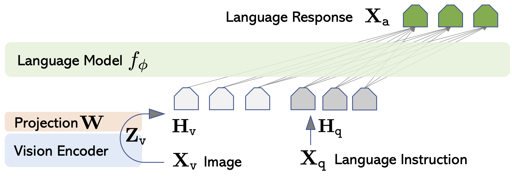

# 第十一章　多模态（Multimodality）

> 译自 Alisa's Book of LLMs "Multimodality" 一节；底稿与约定见 [`05-scaling-laws.md`](05-scaling-laws.md) 页眉说明。原图位于 `../snapshots/llm-book/assets/`。

- **Vision Transformer（ViT）**：把图像变成一串向量，然后照常跑一个标准 Transformer 编码器
- **LLaVA**
  - 语言模型隐藏维度 $D=4096$，CLIP 隐藏维度 1024

  ```
  图像 [224, 224, 3]
      ↓ 切块（patchify）
  图像块 [256, 588]
      ↓ 线性投影（逐块独立）
  图像块嵌入 [256, 1024]
      ↓ 在前面加上 CLS，加位置嵌入
  序列 [257, 1024]
      ↓ CLIP（24 层的 Transformer 编码器）
  CLIP 输出 [256, 1024]
      ↓ 投影 W 逐词元独立施加
  视觉嵌入 [256, 4096]
      ↓ 与文本嵌入 [N, 4096] 拼接
  完整序列 [256 + N, 4096]
      ↓ LLM Transformer
  ```



- **LLaVA-NeXT 的动态分辨率**
  - 把高分辨率图像切成多个裁剪块分别编码，然后拼接起来
- **Qwen2-VL**
  - 以前的做法：输入尺寸固定（比如 224×224）→ 永远是 256 个图像块
    - 于是学习固定形状 $[256, D]$ 的绝对位置嵌入
  - 我们其实只是因为"位置嵌入数量固定"才被迫限制图像尺寸
  - 现在直接用 2D-RoPE：
    - 图像块大小仍然固定
    - 位置用（行, 列）坐标编码
    - RoPE 现场生成位置编码
    - 模型因此能泛化到任意分辨率和任意长宽比
- **当前范式**
  - 理解：ViT 编码器 → 特征
  - 生成：在像素空间上做扩散（diffusion）
- **CLIP**
  - 用对比学习训练
  - 让配对正确的文本/图像嵌入相似度最大化，不配对的压低
