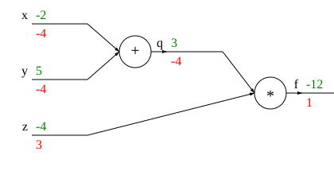
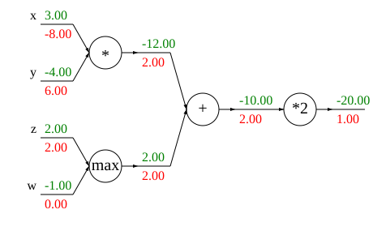

# 反向传播与梯度计算（CS231n）

> 译自：<https://cs231n.github.io/optimization-2/>
> 来源：Stanford CS231n《面向计算机视觉的深度学习》公开课程笔记（页内未署名）；底稿：`../snapshots/readings/cs231n-optimization-2.md`（2026-11-15 快照）
> 译注日期：2026-11-15。原文三张电路图已存至 `../assets/`；术语见根 `glossary.md`；正文中的"课程后面会讲"等说法沿用原文的课程时间线。

目录：

- [引言](#引言)
- [简单表达式与梯度的解读](#简单表达式与梯度的解读)
- [复合表达式与链式法则](#复合表达式与链式法则)
- [对反向传播的直观理解](#对反向传播的直观理解)
- [模块化：Sigmoid 例子](#模块化sigmoid-例子)
- [实践中的反向传播：分阶段计算](#实践中的反向传播分阶段计算)
- [反向流中的模式](#反向流中的模式)
- [向量化运算的梯度](#向量化运算的梯度)
- [总结](#总结)

<span id="引言"></span>

## 引言

**动机**。本节我们将建立对**反向传播（backpropagation）**的直观理解——它是一种通过反复运用**链式法则（chain rule）**来计算表达式梯度的方法。理解这一过程及其细节，对你理解、开发、设计和调试神经网络至关重要。

**问题设定**。本节研究的核心问题如下：给定某个函数 $f(x)$，其中 $x$ 是输入向量，我们想求 $f$ 在 $x$ 处的梯度（即 $\nabla f(x)$）。

**动机（续）**。回想一下我们为什么关心这个问题：在神经网络这个具体场景里，$f$ 就是损失函数（$\mathcal L$），而输入 $x$ 由训练数据和网络权重共同组成。例如，损失可以是 SVM 损失，输入则既包括训练数据 $(x_i, y_i), i=1 \ldots N$，也包括权重和偏置 $W, b$。注意（这也是机器学习中的惯常设定）：我们把训练数据视为给定且固定，把权重视为我们能掌控的变量。因此，虽然反向传播同样可以算出对输入样本 $x_i$ 的梯度，实践中我们通常只计算参数（如 $W, b$）的梯度，以便进行参数更新。不过课程后面会看到，对 $x_i$ 的梯度有时仍然有用，比如用于可视化、解读神经网络可能在做什么。

如果你推导梯度已经熟练，我们仍建议至少浏览一遍本节：这里给出一种很少被展开的视角——把反向传播看作实数值电路中的"反向流动"，从中获得的任何洞见在整门课都会用得上。

<span id="简单表达式与梯度的解读"></span>

## 简单表达式与梯度的解读

从最简单的例子入手，先把记号和约定建立起来，再去处理更复杂的表达式。考虑一个简单的两数乘法 $f(x, y) = xy$。对任一输入求偏导数只是基础微积分：

$$f(x, y) = xy \rightarrow \frac{\partial f}{\partial x} = y \quad \frac{\partial f}{\partial y} = x$$

**解读**。时刻记住导数在告诉你什么：它表示在某个特定点附近一个无穷小邻域内，函数值相对于该变量的变化率：

$$\frac{df(x)}{dx} = \lim_{h \rightarrow 0} \frac{f(x + h) - f(x)}{h}$$

一个技术性说明：左边的除号并非真正的除法，而右边的分式确实是两个量的比。这个记号表示算子 $\frac{d}{dx}$ 作用在函数 $f$ 上，返回另一个函数（即导函数）。上面这个式子有个很好的理解方式：当 $h$ 非常小时，函数可以被一条直线很好地近似，而导数就是这条直线的斜率。换句话说，对某个变量的导数告诉你：**整个表达式对该变量取值的敏感度**。例如，若 $x = 4$、$y = -3$，则 $f(x,y) = -12$，而对 $x$ 的导数 $\frac{\partial f}{\partial x} = -3$。这告诉我们：若把这个变量的值增大一点点，整个表达式的值会（因为符号为负）减小，且减小量是这个"一点点"的三倍。这一点可以由上式移项看出（$f(x + h) = f(x) + h \frac{df(x)}{dx}$）。类似地，因为 $\frac{\partial f}{\partial y} = 4$，我们把 $y$ 增大极小量 $h$ 时，函数的输出会（因为符号为正）增大，增大量为 $4h$。

> 对某个变量的导数，告诉你整个表达式对该变量取值的敏感度。

如前所述，梯度 $\nabla f$ 就是所有偏导数拼成的向量，这里 $\nabla f = [\frac{\partial f}{\partial x}, \frac{\partial f}{\partial y}] = [y, x]$。虽然梯度严格说是一个向量，为了简便，我们常把"对 $x$ 的偏导数"直接说成"对 $x$ 的梯度"。

加法运算的导数同样简单：

$$f(x,y) = x + y \rightarrow \frac{\partial f}{\partial x} = 1 \quad \frac{\partial f}{\partial y} = 1$$

也就是说，无论 $x, y$ 取什么值，对两者的导数都是 1。这很合理：增大 $x$ 或 $y$ 都会增大 $f$ 的输出，且增大的速率与 $x, y$ 的具体取值无关（与上面的乘法不同）。本课程还要大量使用最后一个运算——*max* 运算：

$$f(x,y) = \max(x, y) \rightarrow \frac{\partial f}{\partial x} = \mathbf{1}(x \ge y) \quad \frac{\partial f}{\partial y} = \mathbf{1}(y \ge x)$$

也就是说，（次）梯度在较大的那个输入上是 1，在另一个输入上是 0[^1]。直觉上：若输入为 $x = 4, y = 2$，max 输出 4，函数对 $y$ 的取值不敏感——把 $y$ 增大极小量 $h$，函数仍然输出 4，因此梯度为零：毫无影响。当然，若把 $y$ 改变一个较大量（比如大于 2），$f$ 的值是会变的，但导数并不告诉我们这种大改动的影响——它只对输入上极微小的变化有参考价值，正如定义里的 $\lim_{h \rightarrow 0}$ 所示。

[^1]: 示性函数 $\mathbf{1}(\cdot)$：条件成立取 1，否则取 0。"次梯度"（subgradient）是导数概念在不可导点（如 max 在 $x=y$ 处）的推广；面试语境下按"较大者取 1"理解即可。
<span id="复合表达式与链式法则"></span>

## 复合表达式与链式法则

现在考虑包含多个复合函数的更复杂表达式，例如 $f(x,y,z) = (x + y) z$。这个式子仍然简单到可以直接求导，但我们要用一种特定的拆法来处理它——它对理解反向传播的直觉很有帮助。注意这个表达式可以拆成两个子表达式：$q = x + y$ 和 $f = qz$。而这两部分的导数我们上一节都会算了：$f$ 就是 $q$ 与 $z$ 的乘法，所以 $\frac{\partial f}{\partial q} = z$、$\frac{\partial f}{\partial z} = q$；$q$ 是 $x$ 与 $y$ 的加法，所以 $\frac{\partial q}{\partial x} = 1$、$\frac{\partial q}{\partial y} = 1$。但我们未必关心中间量 $q$ 上的梯度——$\frac{\partial f}{\partial q}$ 本身并不是我们最终要的。我们真正想要的是 $f$ 对其输入 $x, y, z$ 的梯度。**链式法则**告诉我们，把这些梯度表达式正确地"串"起来的方式是相乘，例如 $\frac{\partial f}{\partial x} = \frac{\partial f}{\partial q}\frac{\partial q}{\partial x}$。实际操作里，这就是把持有两段梯度的两个数相乘。看一个具体例子：

```python
# 设一些输入
x = -2; y = 5; z = -4

# 前向传播（forward pass）
q = x + y   # q 变为 3
f = q * z   # f 变为 -12

# 按相反顺序做反向传播（backpropagation）：
# 先穿过 f = q * z 反向
dfdz = q    # df/dz = q，所以 z 上的梯度是 3
dfdq = z    # df/dq = z，所以 q 上的梯度是 -4
dqdx = 1.0
dqdy = 1.0
# 再穿过 q = x + y 反向
dfdx = dfdq * dqdx  # 这里的乘法就是链式法则！
dfdy = dfdq * dqdy
```

于是我们得到 `[dfdx, dfdy, dfdz]`，它们告诉变量 `x, y, z` 对 `f` 的敏感度。这就是反向传播最简单的例子。往后我们会用更简洁的记号，省略 `df` 前缀：例如直接写 `dq` 而不写 `dfdq`，并始终默认梯度是对最终输出计算的。

这个计算过程也可以用电路图漂亮地画出来：



左边的实数"电路"展示了计算的直观表示。**前向传播（forward pass）**从输入到输出计算各处的值（图中绿色）。**反向传播（backward pass）**从末端开始，递归地沿电路反向应用链式法则，把梯度（图中红色）一路算回电路的输入。可以把梯度想象成在电路中向回流淌。

<span id="对反向传播的直观理解"></span>

## 对反向传播的直观理解

注意，反向传播是一个非常优美的**局部**过程。电路图中的每个门（gate）拿到一些输入后，可以立刻算出两样东西：1. 它的输出值；2. 它的输出对其输入的*局部*梯度。注意，每个门完全可以独立地做这些事，对自己所处的整个电路毫不知情。然而，一旦前向传播结束，在反向传播阶段，每个门最终都会得知"它的输出值对整个电路最终输出的梯度"。链式法则说：门应该拿过这个梯度，把它乘到自己为每个输入算出的局部梯度上。

> 链式法则带来的这次额外乘法（对每个输入），能让一个原本孤立无用的门，变成像整个神经网络这样复杂电路中的一颗齿轮。

再回到上面的例子来建立直觉。加法门收到输入 $[-2, 5]$，算出输出 3。由于它做的是加法，它对两个输入的局部梯度都是 +1。电路其余部分算出了最终值 -12。在沿电路反向递归应用链式法则的反向传播中，这个加法门（作为乘法门的输入）得知：它输出上的梯度是 -4。如果我们拟人化地把电路想成"希望输出更大的值"（这有助于建立直觉），那么就可以说电路"希望"加法门的输出**变低**（因为符号为负），"用力"为 4。为了继续这个递归、把梯度串下去，加法门拿过这个梯度，乘到自己对每个输入的局部梯度上（于是 **x** 和 **y** 上的梯度都变成 $1 \times -4 = -4$）。注意这正合期望：若 **x, y** 减小（响应负梯度），加法门的输出就减小，从而让乘法门的输出增大。

因此，反向传播可以被理解为：各个门通过梯度信号互相传达"自己的输出应该升还是降、力度多大"，好让最终输出值更高。

<span id="模块化sigmoid-例子"></span>

## 模块化：Sigmoid 例子

上面介绍的几种门是相当任意的选择。任何可导函数都可以当门；只要方便，我们既可以把多个门合并成一个门，也可以把一个函数拆成多个门。看另一个说明这一点的表达式：

$$f(w,x) = \frac{1}{1+e^{-(w_0x_0 + w_1x_1 + w_2)}}$$

课程后面会看到，这个式子描述的是一个二维神经元（输入为 **x**、权重为 **w**），其激活（activation）使用 *sigmoid 激活函数*。不过现在请把它纯粹看成"从输入 $w, x$ 到一个数的函数"。这个函数由多个门构成。除了前面已介绍的（加法、乘法、max），还需要四个：

$$f(x) = \frac{1}{x} \rightarrow \frac{df}{dx} = -1/x^2$$
$$f_c(x) = c + x \rightarrow \frac{df}{dx} = 1$$
$$f(x) = e^x \rightarrow \frac{df}{dx} = e^x$$
$$f_a(x) = ax \rightarrow \frac{df}{dx} = a$$

其中 $f_c$、$f_a$ 分别把输入平移常量 $c$、缩放常量 $a$。它们严格来说是加法和乘法的特例，但因为常数 $c, a$ 不需要梯度，这里把它们当作（新的）一元门引入。完整的电路如下：

![带 sigmoid 激活的二维神经元电路：输入 [x0,x1]，可学习权重 [w0,w1,w2]；先做点积，输出再被 sigmoid 软压到 0~1 区间](../assets/cs231n-sigmoid-circuit.svg)

上面的例子展示了一长串作用在 **w**·**x** 点积结果上的函数应用。这一串运算实现的函数叫 *sigmoid 函数* $\sigma(x)$。有趣的是，如果对 sigmoid 函数关于其输入求导（其中有个有趣的小技巧：在分子上加个 1 再减个 1），导数会化简得出人意料的简洁：

$$\sigma(x) = \frac{1}{1+e^{-x}} \rightarrow \frac{d\sigma(x)}{dx} = \frac{e^{-x}}{(1+e^{-x})^2} = \left(\frac{1 + e^{-x} - 1}{1 + e^{-x}}\right)\left(\frac{1}{1+e^{-x}}\right) = (1 - \sigma(x))\sigma(x)$$

我们看到梯度化简后出奇地简单。例如，前向传播中 sigmoid 部分接收输入 1.0、算出输出 0.73；上面的推导说明，它的*局部*梯度就只是 $(1 - 0.73) \times 0.73 \approx 0.2$——和前面电路图里逐步算出来的一样，但现在只用一条简单高效的表达式就能算（数值问题也更少）。所以在任何实际实现中，把这些运算打包成一个门都非常有价值。来看这个神经元的反向传播代码：

```python
w = [2,-3,-3]  # 假设一组随机权重和数据
x = [-1, -2]

# 前向传播
dot = w[0]*x[0] + w[1]*x[1] + w[2]
f = 1.0 / (1 + math.exp(-dot))  # sigmoid 函数

# 穿过这个神经元的反向传播（backpropagation）
ddot = (1 - f) * f  # dot 变量上的梯度，用 sigmoid 的导数公式
dx = [w[0] * ddot, w[1] * ddot]           # 反传到 x
dw = [x[0] * ddot, x[1] * ddot, 1.0 * ddot]  # 反传到 w
# 完成！电路所有输入上的梯度都拿到了
```

**实践小贴士：分阶段的反向传播（staged backpropagation）**。如上面的代码所示，实践中把前向传播拆成一段段"容易反传"的阶段总是很有帮助。例如我们引入中间变量 `dot` 保存 `w` 与 `x` 点积的结果；反向时按相反顺序依次算出对应的变量（先 `ddot`，最终到 `dw, dx`），它们保存各变量的梯度。

本节要点在于：反向传播具体怎么执行、把前向函数的哪些部分视作一个门，都是**以方便为准**。清楚表达式的哪些部分有容易计算的局部梯度，就能用最少的工作量把它们串起来。

<span id="实践中的反向传播分阶段计算"></span>

## 实践中的反向传播：分阶段计算

再看一个例子。设有一个形如下式的函数：

$$f(x,y) = \frac{x + \sigma(y)}{\sigma(x) + (x+y)^2}$$

说明一下，这个函数毫无用处，你大概永远用不到它的梯度——它存在的意义就是当反向传播的好例子。必须强调：如果你真去对 $x$ 或 $y$ 硬做符号求导，会得到一条又大又复杂的表达式。但其实完全没必要——我们不需要显式写出计算梯度的公式，只需要知道**怎么算**它。前向传播可以这样组织：

```python
x = 3   # 示例值
y = -4

# 前向传播
sigy = 1.0 / (1 + math.exp(-y))  # 分子中的 sigmoid        #(1)
num = x + sigy                   # 分子                    #(2)
sigx = 1.0 / (1 + math.exp(-x))  # 分母中的 sigmoid        #(3)
xpy = x + y                                               #(4)
xpysqr = xpy**2                                           #(5)
den = sigx + xpysqr              # 分母                    #(6)
invden = 1.0 / den                                        #(7)
f = num * invden                 # 搞定！                  #(8)
```

呼，走到表达式末尾，前向传播就算完了。注意我们特意把代码组织成包含多个中间变量的形式，每个中间变量都只是我们已经会算局部梯度的简单表达式。于是反向传播就容易了：倒着走，对前向中的每个变量（`sigy, num, sigx, xpy, xpysqr, den, invden`）都设一个带前缀 `d` 的同名变量，保存电路输出对该变量的梯度。并且，反向传播的每一步都只需：算该步的局部梯度，再把它与该步上游梯度**相乘**串联。每行都标注了对应前向传播的哪一步：

```python
# 反传 f = num * invden
dnum = invden                                    # 分子的梯度   #(8)
dinvden = num                                    #(8)
# 反传 invden = 1.0 / den
dden = (-1.0 / (den**2)) * dinvden               #(7)
# 反传 den = sigx + xpysqr
dsigx = (1) * dden                               #(6)
dxpysqr = (1) * dden                             #(6)
# 反传 xpysqr = xpy**2
dxpy = (2 * xpy) * dxpysqr                       #(5)
# 反传 xpy = x + y
dx = (1) * dxpy                                  #(4)
dy = (1) * dxpy                                  #(4)
# 反传 sigx = 1.0 / (1 + math.exp(-x))
dx += ((1 - sigx) * sigx) * dsigx  # 注意 +=！见下文   #(3)
# 反传 num = x + sigy
dx += (1) * dnum                                 #(2)
dsigy = (1) * dnum                               #(2)
# 反传 sigy = 1.0 / (1 + math.exp(-y))
dy += ((1 - sigy) * sigy) * dsigy                #(1)
# 完成！呼
```

注意几个要点：

**缓存前向传播的变量**。计算反向传播时，前向用过的某些变量非常有用。实际写代码应把这些变量缓存下来，供反向传播取用。若实在不便，重算一遍也可行——只是浪费。

**梯度在分叉处相加**。前向表达式里变量 **x, y** 被用到多次，反向传播时必须小心：对这些变量的梯度要用 `+=` **累加**，而不是 `=` 覆盖。这正是微积分中的*多元链式法则*：一个变量分叉流向电路的不同部分时，流回它的各路梯度要相加。

<span id="反向流中的模式"></span>

## 反向流中的模式

值得一提的是，很多时候反向流动的梯度可以有直观层面的解读。神经网络最常用的三种门（*加法、乘法、max*）在反向传播中的行为都有非常简单的解释。考虑这个电路例子：



以上图为例，可以看到：

**加法门**总是把输出上的梯度平均分配给所有输入，不管前向时各输入的值是多少。原因是加法的局部梯度就是 +1.0，各输入上的梯度与输出上的梯度完全相等（乘以 1.0 不变）。图中 + 门把 2.00 的梯度原样、均匀地发给了两个输入。

**max 门**路由梯度。与加法门把梯度原样发给所有输入不同，max 门把梯度（原样）只发给其中一个输入——前向时取值最大的那个。这是因为 max 门的局部梯度在最大值那个输入上是 1.0，在其余输入上是 0.0。图中 max 运算把 2.00 的梯度发给了 **z**（其值大于 **w**），**w** 上的梯度保持为零。

**乘法门**的解释稍微绕一点：它的局部梯度是（互换后的）输入值，再乘上链式法则传来的输出梯度。上例中 **x** 上的梯度是 -8.00，即 $-4.00 \times 2.00$。

*反直觉的效应及其后果*。注意：如果乘法门的一个输入非常小、另一个非常大，乘法门会做出略反直觉的事——给小输入分配相当大的梯度，给大输入分配很小的梯度。在线性分类器中，权重与输入做点积 $\mathbf{w}^T x_i$（乘法），这意味着**数据的尺度会影响权重梯度的大小**。例如，若你把所有输入样本 $x_i$ 都乘了 1000，权重的梯度就会大 1000 倍，你得把学习率相应调小 1000 倍来补偿。这就是数据预处理有时会有微妙而重大影响的原因！对梯度如何流动建立直观理解，能帮你调试这类问题。

<span id="向量化运算的梯度"></span>

## 向量化运算的梯度

前面都只处理单个变量，但所有概念都可以直接推广到矩阵和向量运算，只是必须更留心维度和转置。

**矩阵乘矩阵的梯度**。也许最棘手的是矩阵-矩阵乘法（它推广了矩阵-向量和向量-向量乘法）：

```python
# 前向传播
W = np.random.randn(5, 10)
X = np.random.randn(10, 3)
D = W.dot(X)

# 假设从电路上游得到了 D 上的梯度
dD = np.random.randn(*D.shape)  # 与 D 同形状
dW = dD.dot(X.T)  # .T 是矩阵转置
dX = W.T.dot(dD)
```

**技巧：用维度做检查！** 你不需要死记 `dW` 和 `dX` 的公式，因为凭维度就能重新推导。例如我们知道：算出的权重梯度 `dW` 必须与 `W` 同形状，而且它必须由 `X` 和 `dD` 的矩阵乘法组合而来（当 $X, W$ 都是单个数时情况正是如此）。满足维度要求的方式有且只有一种：`X` 是 \[10×3\]、`dD` 是 \[5×3\]，而 `dW` 要和 \[5×10\] 的 `W` 同形，那唯一写法就是 `dD.dot(X.T)`。

**先写最小的显式例子**。有些同学起初会觉得向量表达式的梯度更新不好推。我们的建议是：先写出一个最小的向量例子，在纸上推出梯度，再把规律推广成高效的向量化形式。

Erik Learned-Miller 写过一篇更长的矩阵/向量求导笔记，可能对你有用，[见这里](http://cs231n.stanford.edu/vecDerivs.pdf)。

<span id="总结"></span>

## 总结

- 我们建立了对梯度含义的直觉：它在电路中如何反向流动，如何传达"电路的哪部分应该升、哪部分应该降、力度多大"，以使最终输出更高。
- 我们讨论了**分阶段计算**在反向传播实现中的重要性：永远要把函数拆成能轻松求出局部梯度的模块，再用链式法则把它们串起来。关键是：几乎永远不要把完整表达式写在纸面上做符号求导，因为你永远不需要一个显式的梯度公式。把表达式分解成一段段可以独立求导的阶段（矩阵乘向量、max、求和等），然后一步一步地反传。

下一节我们开始定义神经网络，反向传播将让我们高效计算损失函数关于参数的梯度。换句话说，我们终于要开始训练神经网络了，这门课概念上最难的部分已经过去！卷积网络（ConvNet）只是下一小步。

### 参考文献

- [Automatic differentiation in machine learning: a survey](http://arxiv.org/abs/1502.05767)
