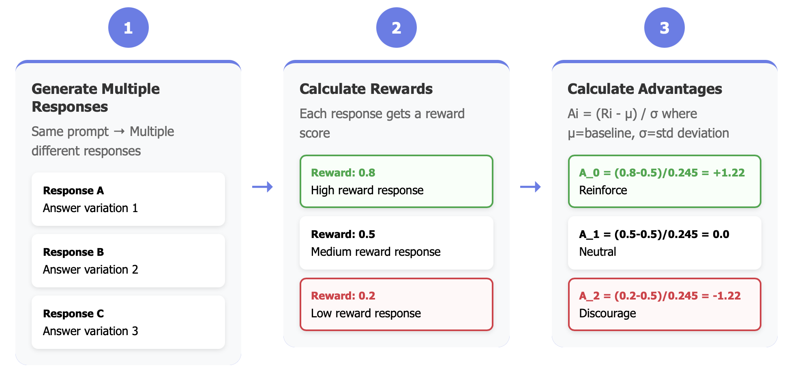
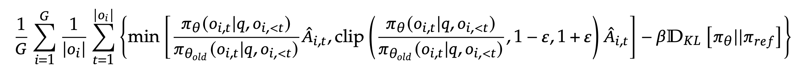

# GRPO 与强化学习原理轻量指南

> 译自：<https://gitlostmurali.com/blog/grpo-intro>（页面标注"阅读时长 8 分钟"，更新日期 2025-09-13）
> 来源：gitlostmurali.com（博客名 "Musings of Murali"，页内未署全名）；底稿：`../snapshots/readings/gitlostmurali-grpo-intro.md`（2026-11-15 快照）
> 译注日期：2026-11-15。原文两张配图已存 `../assets/`；图 2 的公式为位图，已识图还原为 LaTeX 并以文本呈现。术语见根 `glossary.md`。

本页目录：

- [背景与动机](#背景与动机)
- [GRPO 是什么？](#grpo-是什么)
  - [为什么要用优势？](#为什么要用优势)
  - [现在，把它写成代码](#现在把它写成代码)
- [隐藏的挑战：在"过期"数据上训练](#隐藏的挑战在过期数据上训练)
- [为什么这是个问题？](#为什么这是个问题)
- [解法：重要性采样](#解法重要性采样)
- [加上护栏：裁剪机制](#加上护栏裁剪机制)
- [为什么不干脆每一步都生成新数据？](#为什么不干脆每一步都生成新数据)
  - [同策略训练（"理想"做法）](#同策略训练理想做法)
  - [异策略训练（"省钱"做法）](#异策略训练省钱做法)
- [领域内的有趣进展](#领域内的有趣进展)
  - [1. KL 散度消失了](#1-kl-散度消失了)
  - [2. 为什么 GRPO/RL 比 SFT 更少"遗忘"？](#2-为什么-grporl-比-sft-更少遗忘)
  - [3. 聚焦"分叉词元"](#3-聚焦分叉词元)

## 背景与动机

这是一篇小博客，帮你理解 GRPO（Group Relative Policy Optimization，组相对策略优化）的训练流程。这是我自己动手实现训练流程之前，想找却没找到的那块拼图。

大多数内容创作者默认读者已经了解 GRPO 的前辈们（DPO/PPO 之类），然后才开讲 GRPO——这显然会把没有强化学习背景的人挡在门外。如果你从没接触过 RL（Reinforcement Learning，强化学习），来对地方了。

---

## GRPO 是什么？

GRPO 遵循 FAFO 原则——Fool Around and Find Out，"试了才知道"。它的流程简述如下：对同一个提示词生成多个回答，给每个回答计算优势（advantage），然后教导模型偏好优势更高的回答、压低优势较低的回答。



**图 1：GRPO 训练流程总览**

### 为什么要用优势？

虽然奖励本身已经能表明某个回答是不是更好，但你真正想知道的是：**相对于同一个问题的其他回答，这个回答好多少**。这就是优势的用途。优势的计算方式是：用同组奖励的均值和标准差对奖励做归一化。

GRPO 的核心目标函数是：



**图 2：GRPO 目标函数**（原图为位图，识图还原如下）

$$\frac{1}{G}\sum_{i=1}^{G}\frac{1}{|o_i|}\sum_{t=1}^{|o_i|}\left\{\min\left[\frac{\pi_\theta(o_{i,t}\mid q,o_{i,<t})}{\pi_{\theta_{old}}(o_{i,t}\mid q,o_{i,<t})}\hat{A}_{i,t},\ \mathrm{clip}\left(\frac{\pi_\theta(o_{i,t}\mid q,o_{i,<t})}{\pi_{\theta_{old}}(o_{i,t}\mid q,o_{i,<t})},1-\varepsilon,1+\varepsilon\right)\hat{A}_{i,t}\right]-\beta\,\mathbb{D}_{KL}[\pi_\theta\|\pi_{ref}]\right\}$$

好吧，又长又吓人。我们只盯住上面那个"最小单元"，也就是

$$\mathcal{L}_{GRPO} = \frac{1}{G} \sum_{i=1}^{G} \frac{1}{|o_i|} \sum_{t=1}^{|o_i|} \pi_\theta(o_{i,t}\mid q, o_{i,<t})\, \hat{A}_{i,t}$$

### 现在，把它写成代码

本质上，我们对外层的每个生成回答 $i = 1$ 到 $G$ 循环；在每个回答内部，对其中每个词元 $t = 1$ 到 $|o_i|$ 循环，其中 $|o_i|$ 是第 $i$ 个回答的词元数。所以，这就是对 $\pi_\theta$ 做 $i$、$t$ 两层嵌套 for 循环。

式子里的 $\pi_\theta$ 指的就是：在给定问题 $q$ 和前面已生成的词元 $o_{i,<t}$ 的条件下，词元 $o_{i,t}$ 的对数概率（log probability）。

上面这个式子的等价代码如下：

```python
for each_generated_answer_i in generated_answers:  # 式中的 G
    advantage = calculate_advantage(each_generated_answer_i)
    for each_token_o_t in each_generated_answer_i:  # 式中的 |o_i|
        token_loss = pi_theta(each_token_o_t) * advantage

    loss_of_each_answer = sum(tokens_loss_in_answer_i) / len(each_generated_answer_i)

final_loss = sum(loss_of_all_answers) / len(generated_answers)  # 式中的 G
```

从下面的图 3（与图 1 相同）可以看到，优势是在**序列级/回答级**计算的。因此对每个词元，损失都取该词元 $o_{i,t}$ 的对数概率与优势（$\hat{A}_{i,t}$）的乘积：

$$\text{token\_loss} = \pi_\theta(o_{i,t}\mid q, o_{i,<t}) \times \hat{A}_{i,t}$$


**图 3：GRPO 流程总览**

轻松搞定！GRPO 损失计算的"最小单元"我们已经实现了——它只是对每个回答的词元损失做两层嵌套 for 循环：

$$\mathcal{L}_{GRPO} = \frac{1}{G} \sum_{i=1}^{G} \frac{1}{|o_i|} \sum_{t=1}^{|o_i|} \text{token\_loss}$$

其中 `token_loss` 是回答中每个词元的损失，即

$$\text{token\_loss} = \pi_\theta(o_{i,t}\mid q, o_{i,<t}) \times \hat{A}_{i,t}$$

## 隐藏的挑战：在"过期"数据上训练

到目前为止我们看的是 GRPO 损失的基本计算。但 GRPO 训练时实际发生的事，会制造一个有意思的挑战：

1. 用当前模型生成一批回答（比如每个提示词 4 个回答）
2. 给这些回答计算优势（谁好谁差）
3. 在**同一批**数据上连续训练多个梯度步（比如 10 步）

问题就在这：回答只生成**一次**，却被训练**很多次**。效率是很高，但会带来一个微妙的问题。

## 为什么这是个问题？

想一想：到了第 10 个梯度步，你的模型已经被训练得变了很多，但我们用的还是第 1 步时的模型生成的回答！

这就像拿上周的自己投篮的视频来纠正投篮动作——你这段时间已经进步了，视频早已代表不了你现在的姿势。这种"错位"叫分布偏移（distribution shift），对应的做法叫异策略（off-policy）训练。

如果对这个问题视而不见，会出什么事：

```python
# 用初始模型生成回答
answers = model.generate(prompt)  # 第 0 步的模型
advantages = calculate_advantages(answers)

# 在同一批回答上训练多个步数
for step in range(10):
    log_probs = model.get_log_probs(answers)  # 第 1、2、…、10 步的模型
    loss = log_probs * advantages
    model.update(loss)
    # 到第 10 步，我们计算梯度时假装这批回答是当前模型生成的，
    # 但它并没有！生成它们的是第 0 步的模型！
```

这会导致梯度越来越有偏、训练越来越不稳。模型甚至可能"忘掉"好的行为——它搞不清数据从哪来，也想不通为什么回答从第 1 步到第 10 步都没变、梯度更新却开始不对劲。

## 解法：重要性采样

这就是 $\pi_{\theta_{old}}$ 登场的地方。我们记下**真正**生成这些回答的那个模型（"旧"模型）的对数概率，用它来修正损失计算：

$$\text{token\_loss} = \frac{\pi_\theta(o_{i,t}\mid q, o_{i,<t})}{\pi_{\theta_{old}}(o_{i,t}\mid q, o_{i,<t})} \times \hat{A}_{i,t}$$

这个比值 $\frac{\pi_\theta}{\pi_{\theta_{old}}}$ 叫**重要性采样比**（importance sampling ratio）。它在告诉我们：

- 比值 > 1：当前模型比旧模型**更**喜欢这个词元 → 放大梯度
- 比值 < 1：当前模型比旧模型**更不**喜欢这个词元 → 缩小梯度
- 比值 = 1：两个模型意见一致 → 梯度不变

代码版：

```python
# 只用初始模型生成一次回答
answers = old_model.generate(prompt)
old_log_probs = old_model.get_log_probs(answers)  # 存下来！
advantages = calculate_advantages(answers)

# 现在我们可以放心地训练多个步数
for step in range(10):
    current_log_probs = model.get_log_probs(answers)

    # 神奇的修正因子
    importance_ratio = exp(current_log_probs - old_log_probs)

    # 计入分布偏移修正的损失
    loss = importance_ratio * advantages
    model.update(loss)
```

这个修正保证了即使我们在"过期"数据上训练，梯度在数学上仍然是合法的。就好比根据"你进步了多少"来调整对着上周视频练投篮的方式。

## 加上护栏：裁剪机制

可如果重要性比值变得很极端怎么办？假设当前模型和旧模型的意见**非常**不一致（比值 = 100 或 0.01），训练可能直接爆炸或崩掉。

GRPO 加了一层安全机制：把比值裁剪（clip）在合理范围内：

$$\text{ratio}_{clipped} = \mathrm{clip}(\text{ratio},\ 1-\varepsilon,\ 1+\varepsilon)$$

取 ε = 0.2（常用值），比值就只能落在 0.8 到 1.2 之间。这样即使两个模型分歧很大，任何单次更新也不会太激进。

加上裁剪后的完整 GRPO 目标：

$$\mathcal{L}_{GRPO} = \frac{1}{G} \sum_{i=1}^{G} \frac{1}{|o_i|} \sum_{t=1}^{|o_i|} \min\left(\text{ratio}_{i,t} \times \hat{A}_{i,t},\ \mathrm{clip}(\text{ratio}_{i,t},\ 1-\varepsilon,\ 1+\varepsilon) \times \hat{A}_{i,t}\right)$$

裁剪是一种保守的选择：宁可梯度修正不完美，也要训练稳定。

```python
# 加上安全裁剪
importance_ratio = exp(current_log_probs - old_log_probs)
clipped_ratio = torch.clip(importance_ratio, 0.8, 1.2)  # ε = 0.2

# 取"裁剪前"与"裁剪后"两个目标里更小的那个
loss_unclipped = importance_ratio * advantages
loss_clipped = clipped_ratio * advantages
loss = torch.min(loss_unclipped, loss_clipped)
```

## 为什么不干脆每一步都生成新数据？

你也许会问：又重要性采样又裁剪，折腾这一大套干什么？为什么不直接每个梯度步都生成新鲜回答？

这触及强化学习的一个基本概念：**同策略（on-policy）与异策略（off-policy）训练**。先把这两个词讲清楚。

### 同策略训练（"理想"做法）

同策略训练：每次梯度更新都用当前模型生成新数据：

```python
for step in range(training_steps):
    # 用当前模型生成新鲜数据
    answers = current_model.generate(prompt)
    advantages = calculate_advantages(answers)
    log_probs = current_model.get_log_probs(answers)

    # 简单干净的损失计算
    loss = log_probs * advantages
    current_model.update(loss)
```

这种做法简单得多、数学上也干净得多——你的梯度永远是在"当前模型亲手生成"的数据上计算的。没有分布偏移，没有过期数据问题。

### 异策略训练（"省钱"做法）

前面见到的就是它。异策略训练复用模型旧版本生成的数据：

```python
# 用当前模型生成一次
answers = current_model.generate(prompt)
old_log_probs = current_model.get_log_probs(answers)
advantages = calculate_advantages(answers)

for step in range(10):  # 同一批数据复用于多个步数
    new_log_probs = current_model.get_log_probs(answers)

    # 需要重要性采样来修正"过期"问题
    importance_ratio = exp(new_log_probs - old_log_probs)
    loss = importance_ratio * advantages
    current_model.update(loss)
```

| - | 同策略（On-policy） | 异策略（Off-policy） |
| --- | --- | --- |
| 优点 | • 数学上更干净（不需要修正因子）<br />• 始终用"当前策略的新鲜数据"训练<br />• 梯度就是你以为的那个梯度 | • 样本效率高——昂贵的生成结果可以多次复用<br />• 实际速度快得多（生成次数可少 10 倍）<br />• 算力利用率更高 |
| 缺点 | • 极其昂贵！生成 LLM 回答需要完整的带采样前向计算<br />• 浪费算力——每批数据用完一个梯度步就扔<br />• 以真实时间衡量的收敛更慢 | • 需要复杂的修正（重要性采样）<br />• 模型变化太大时有不稳定风险<br />• 梯度从精确值变成了近似值 |

## 领域内的有趣进展

### 1. KL 散度消失了

注意，**我上面没有讲目标函数里的 KL 散度项**。这是因为最新研究已经证明：目标函数里并不需要 KL 散度。

去看最近的 GRPO 实现，你会发现一个有趣的现象：所有人都把 `β = 0`，等于把 KL 散度项整个去掉了！原来我们前面讲的裁剪机制已经足以阻止模型改得太剧烈。引用 [Qingfeng 的博客](https://lancelqf.github.io/note/llm_post_training/)："被裁剪的目标在形式上本来就是'以 KL 散度项约束策略'这一做法的替代品，因此再额外加 KL 散度项在理论上没有必要。"

### 2. 为什么 GRPO/RL 比 SFT 更少"遗忘"？

["RL's Razor"](https://arxiv.org/abs/2509.04259)（Shenfeld 等，2025）[^1]这篇论文表明：RL 微调——尤其是同策略训练——比 SFT（Supervised Fine-Tuning，监督微调）遗忘得更少，即使两者在新任务上达到同样的水平。如果你想在新任务上训练、同时保住原模型在标准基准上的表现，这就是好消息。

### 3. 聚焦"分叉词元"

["Beyond the 80/20 Rule"](https://arxiv.org/pdf/2506.01939)（Wang 等，2025）发现：推理链里实际影响学习与思考探索的词元只占约 20%。正是这些位于决策点上的"分叉词元"（forking tokens）贡献了几乎全部性能提升。

**只**用这 20% 的词元训练，性能不但没掉，反而更好！

# 结语

这就是理解 GRPO 与强化学习原理的轻量指南，希望对你有帮助。

---

[^1]: 译注：原文此处链接 Markdown 语法残缺（方括号与圆括号粘连），链接目标 2509.04259 指向 arXiv 论文 "RL's Razor"，本译文按意图恢复为正常链接。
