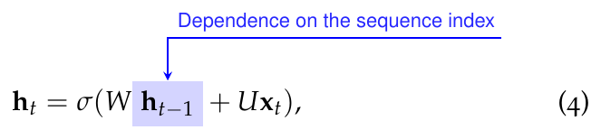
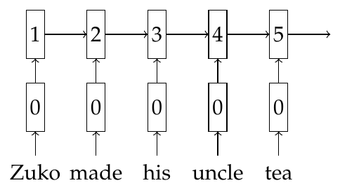
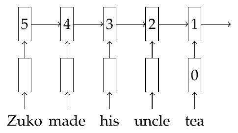
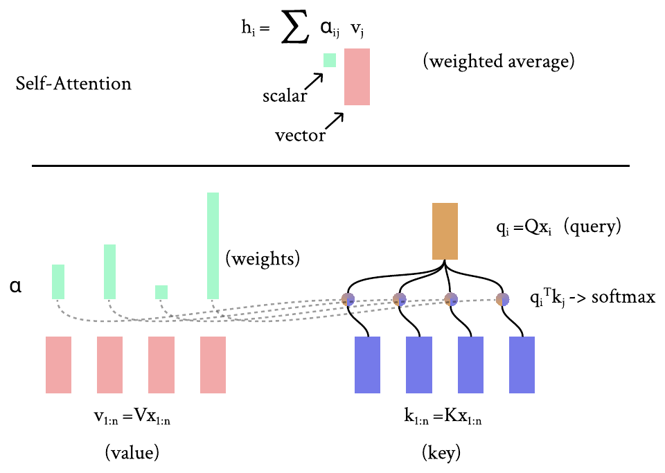
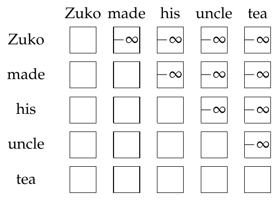
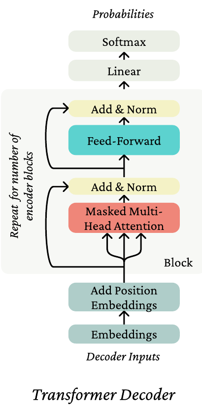
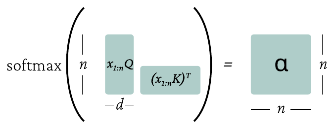
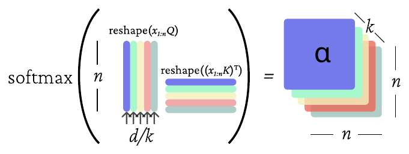
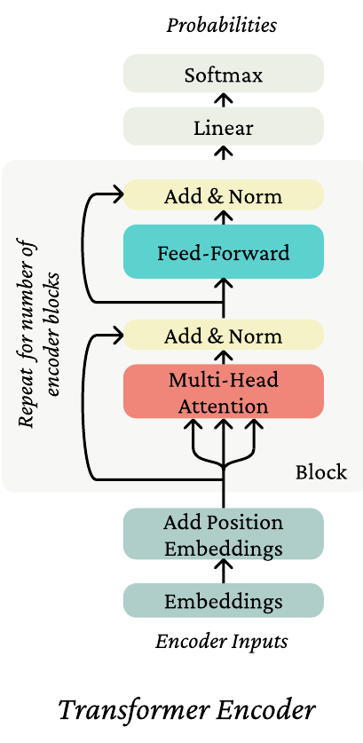
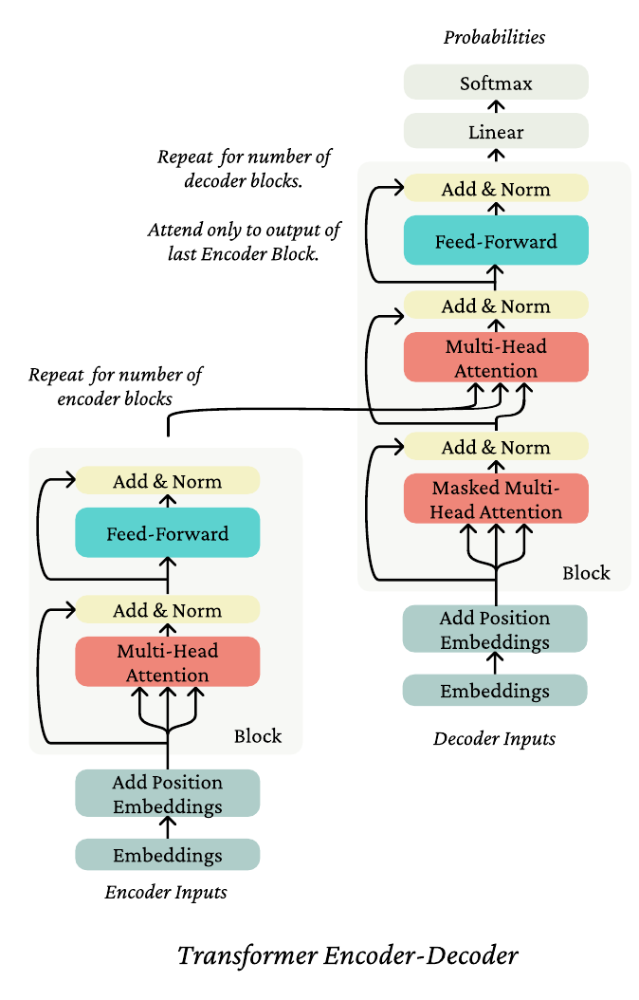

# 讲义十：自注意力与 Transformer（CS224n）

> 译自：[draft] Note 10: Self-Attention & Transformers（CS224n《深度学习自然语言处理》，2023 年冬季学期讲义，作者 John Hewitt，johnhew@cs.stanford.edu；课程主讲：Christopher Manning, John Hewitt）
> 原始 PDF：<https://web.stanford.edu/class/cs224n/readings/cs224n-self-attention-transformers-2023_draft.pdf>；底稿：`../snapshots/readings/cs224n-note10-en.md`（主会话逐页识图转写，2026-11-15）
> 译注日期：2026-11-15。讲义原图已从 PDF 按页裁剪嵌入正文（裁剪件存 `../snapshots/readings/cs224n-figures/`，完整页面存 `../snapshots/readings/cs224n-pages/`）；图下斜体注为对图内容的中文说明。术语见根 `glossary.md`。

> 摘要（Summary）。本讲义说明为什么要摆脱 NLP 中的循环（recurrent）架构；引入自注意力（self-attention）；搭建一个最小的、基于自注意力的神经网络结构；最后深入讲解 Transformer 架构的细节——这是一种基于自注意力的架构，截至 2023 年已是 NLP 研究的绝对主流。

## 1 神经网络架构及其性质

自然语言处理的进步，往往由"通才型技术"加速：它们在大量场景里都比早期方法做得更好。有时，新想法是为了解决老问题；另一些时候，老技术会因为数据或算力刚刚变得可得而重新走红。这样的例子包括隐马尔可夫模型 [Baum and Petrie, 1966]、条件随机场 [Lafferty et al., 2001]、循环神经网络 [Rumelhart et al., 1985]、卷积神经网络 [LeCun et al., 1989] 和支持向量机 [Cortes and Vapnik, 1995]。

本节我们先讨论一下 Cs 224n 迄今讲过的神经网络建模方法，以及它们的局限（外加外部世界的变化）如何催生了 2023 年前后自注意力与 Transformer 架构独领风骚的局面。

### 1.1 记号与基础

设 $\mathbf{w}_{1:n}$ 是一个序列，其中每个 $\mathbf{w}_i \in \mathcal{V}$，$\mathcal{V}$ 为有限词表。我们还会把 $\mathbf{w}_{1:n}$ 记号复用，指代由 one-hot 向量堆成的矩阵 $\mathbf{w}_{1:n} \in \mathbb{R}^{n \times |\mathcal{V}|}$。我们用 $\mathbf{w} \in \mathcal{V}$ 表示任意词表元素，用 $\mathbf{w}_i \in \mathcal{V}$ 表示序列 $\mathbf{w}_{1:n}$ 中特定下标的元素。我们将使用记号

$$\mathbf{w}_t \sim \text{softmax}(f(\mathbf{w}_{1:t-1})), \tag{1}$$

来表示"在某个模型下，$w_t$ 依波浪号 $\sim$ 右侧定义的分布抽样"。因此在这个例子里，$f(\mathbf{w}_{1:t-1})$ 应当属于 $\mathbb{R}^{|\mathcal{V}|}$。我们使用 softmax 函数（如上面这样）时，不直接说明它在哪一维上做归一化，按如下规则理解即可：若 $A$ 是形状为 $\mathbb{R}^{\ell \times d}$ 的张量，softmax 按下式计算：

$$\text{softmax}(A)_{i,j} = \frac{\exp A_{i,j}}{\sum_{j'=1}^{d} \exp A_{i,j'}}, \tag{2}$$

对所有 $i \in \{1,\ldots,\ell\}$、$j \in \{1,\ldots,d\}$ 成立；多于两个轴的张量同理。也就是说，若有张量 $B \in \mathbb{R}^{m,\ell,d}$，我们会在**最后一维**上同样地定义 softmax。冒着啰嗦的风险写完整：

$$\text{softmax}(B)_{q,i,j} = \frac{\exp B_{q,i,j}}{\sum_{j'=1}^{d} \exp B_{q,i,j'}}. \tag{3}$$

在所有方法中，我们都假设存在一个**嵌入矩阵（embedding matrix）** $E \in \mathbb{R}^{d \times |\mathcal{V}|}$，把词表空间映到**隐藏维度** $d$，写作 $E\mathbf{x} \in \mathbb{R}^{d}$。

> 边注（第 2 页）：嵌入的定义。

序列 $\mathbf{w}_{1:n}$ 中某个词元的嵌入 $E\mathbf{w}_i$ 是所谓的**非上下文相关（non-contextual）表示**：尽管 $\mathbf{w}_i$ 出现在序列里，表示 $E\mathbf{w}_i$ 却与上下文无关。由于我们几乎总是在 $\mathbf{w}_{1:n}$ 的嵌入版本上工作，以下记 $\mathbf{x} = E\mathbf{w}$，且 $\mathbf{x}_{1:n} = \mathbf{w}_{1:n}E^{\top} \in \mathbb{R}^{n \times d}$。本讲义讨论的方法有一个总目标：为词元发展强大的**上下文相关（contextual）表示**——即一个代表 $\mathbf{w}_i$、但作为整个序列 $\mathbf{x}_{1:n}$（在语言建模场景下是前缀 $\mathbf{x}_{1:i}$）之函数的表示 $\mathbf{h}_i$。

> 边注（第 2 页）：序列 $\mathbf{x}_{1:n}$ 中词元 $\mathbf{x}_i$ 的非上下文相关表示只取决于 $\mathbf{x}_i$ 的"身份"；而 $\mathbf{x}_i$ 的上下文相关表示取决于整个序列（或前缀 $\mathbf{x}_{1:i}$）。

### 1.2 2017 年前后的默认选择：循环神经网络

通用建模技术与表示在 NLP 里历史悠久，各技术的兴浮沉落交替发生。词嵌入（word embeddings）的历史，就远比我们前几节课学的 word2vec 嵌入长得多 [Schütze, 1992]。同样地，循环神经网络在建模问题上的历史也漫长而反复 [Elman, 1990, Bengio et al., 2000]。不过到了 2017 年，解决一个 NLP 任务的标准打法就是：先从循环神经网络入手。

课程前面已经讲过 RNN，但这里值得把一般形式再写一遍。简单形式的 RNN 如下：

原图（讲义第 2 页原图）：一条蓝色弯曲箭头从上方的蓝色标注文字 "Dependence on the sequence index"（对序列下标的依赖）指向公式中的 $\mathbf{h}_{t-1}$（该项以淡蓝底纹标出）。

$$\mathbf{h}_t = \sigma(W\mathbf{h}_{t-1} + U\mathbf{x}_t), \tag{4}$$

其中 $\mathbf{h}_t \in \mathbb{R}^{d}$，$U \in \mathbb{R}^{d \times d}$，$W \in \mathbb{R}^{d \times d}$。到 2017 年，人们认为这种循环神经网络形式存在**两方面**问题，而它们都与公式 (4) 中被高亮标出的"对序列下标的依赖"（常被称为对"时间"的依赖）有关。

***对序列下标的依赖导致无法并行。*** 现代图形处理器（GPU）极擅长把大量简单运算（比如加法）*并行*地算完。例如，我有矩阵 $A \in \mathbb{R}^{n \times k}$ 和 $B \in \mathbb{R}^{k \times d}$ 时，GPU 计算 $AB \in \mathbb{R}^{n \times d}$ 快得飞起。然而"运算能并行"这一前提是至关重要的——用最朴素的方式算 $AB$，我做的是"一堆乘法 + 一堆加法"，它们大多不互相依赖彼此的结果。但在循环神经网络里，当我计算

$$\mathbf{h}_2 = \sigma(W\mathbf{h}_1 + U\mathbf{x}_2) \tag{5}$$

时，不先知道 $\mathbf{h}_1$ 就算不出 $\mathbf{h}_2$，所以可以展开成

$$\mathbf{h}_2 = \sigma(W(\sigma(W\mathbf{h}_0 + U\mathbf{x}_1) + U\mathbf{x}_2). \tag{6}$$

同样，想算 $\mathbf{h}_3$ 就得先有 $\mathbf{h}_2$，而 $\mathbf{h}_2$ 又依赖 $\mathbf{h}_1$，依此类推。用图来看就是图 1 的样子。序列越长，**由于串行依赖的数目摆在那里，一张 GPU 能把网络的计算并行化到何种程度是有上限的**（"串行"就是一个接一个）。

原图（讲义第 3 页原图）：RNN 沿时间展开的水平链式图。上排 5 个方框依次标 1、2、3、4、5，左端有入箭头，框间以右向箭头相连（第 1 框到第 2 框的连线加粗黑色，其余细灰线），末端有出箭头；每个上排框向下连到下排对应的 5 个方框（均标 0），下排框下方引线依次连到句子 "Zuko made his uncle tea"。

**图 1：** 沿时间展开的 RNN。方框是 RNN 的中间状态（例如上排是嵌入层，下排是每个时间步的 RNN 隐藏状态），框中的数字是"算出该中间状态之前必须完成的串行运算次数"。

随着 GPU（以及后来的张量处理器 TPU 等其他加速器）越来越强、研究者想更充分榨干它们，这种对时间的依赖就再也无法忍受了。

***线性交互距离。*** RNN 的另一个相关问题是：序列中相距较远的词元彼此*交互*很困难。这里"交互"是指：一个词元（已经在过去被观察到）的存在，能否有效地影响另一个词元的加工。例如在句子

The chef₁ who ran out of blackberries and went to the stores₅ is₁

（厨师₁ 把黑莓用完了，于是去了商店₅，他₁……）

中，把 *chef*（厨师）和 *is* 隔开的中间计算——矩阵乘法、非线性函数之类——的数量随两词之间单词数线性增长。我们在图 2 中可视化这一点。

原图（讲义第 4 页原图）：沿时间展开的 RNN 水平链式图，与图 1 同构，但上排方框自左至右标 5、4、3、2、1（递减），框间为左向箭头，右端出箭头，最后一段（1 右侧）加粗、其余细灰线；下排 5 个方框前 4 个为空、最右标 0；下排引线连到同一句子。与图 1 的区别：此处框中数字表示"该词的信息要传到某个中间状态所需的运算数"。

**图 2：** 沿时间展开的 RNN。方框是 RNN 的中间状态（例如上排是嵌入层，下排是每个时间步的隐藏状态），框中的数字约等于"词 *tea* 的词义信息与每个中间状态相隔的运算数"。

直觉上，研究者认为线性交互距离是个问题，因为：在一个词被观察之后还要经过大量运算时，网络很难精确地"回忆起"这个词的出现。这会让网络难以学会"相距较远的词应当如何影响当前词的表示"。

这种"序列元素之间**直接交互**"的想法，也许会让你想起机器翻译里的注意力机制 [Bahdanau et al., 2014]。在那个场景里，生成译文时，我们学会了每生成一个词就回头"看"一次源序列。本讲义则要给出一种完全基于注意力的、可以整体取代循环神经网络的方案。它能同时解决 RNN 的并行化问题和线性交互距离问题。

## 2 一个最小的自注意力架构

广义地讲，注意力是这样一种方法：拿着一个查询（query），在"键-值存储"中做软查询——挑出与查询最像的键，取其对应值。所谓"挑"和"最像"，指的是对所有值做加权平均，与查询越像的键对应的值权重越大。在**自注意力（self-attention）**中，我们指的是：定义查询所用的元素，与定义键和值所用的元素，来自同一批东西。

本节讨论如何用"上下文化的核心机制是注意力而非循环"的方法来构建上下文相关表示。

### 2.1 键-查询-值自注意力机制

自注意力有很多形式；这里讨论的是目前最流行的一种，叫键-查询-值（key-query-value）自注意力。

考虑序列 $\mathbf{x}_{1:n}$ 中的一个词元 $\mathbf{x}_i$。由它定义一个查询 $\mathbf{q}_i = Q\mathbf{x}_i$，其中矩阵 $Q \in \mathbb{R}^{d \times d}$。然后，对序列中的每个词元 $\mathbf{x}_j \in \{\mathbf{x}_1,\ldots,\mathbf{x}_n\}$，我们用另外两个权重矩阵同样地定义键和值：$\mathbf{k}_j = K\mathbf{x}_j$、$\mathbf{v}_j = V\mathbf{x}_j$，其中 $K \in \mathbb{R}^{d \times d}$、$V \in \mathbb{R}^{d \times d}$。

我们把 $\mathbf{x}_i$ 的上下文相关表示 $\mathbf{h}_i$ 定义为序列各值的线性组合（即加权求和）：

$$\mathbf{h}_i = \sum_{j=1}^{n} \alpha_{ij}\mathbf{v}_j, \tag{7}$$

其中权重 $\alpha_{ij}$ 控制每个 $\mathbf{v}_j$ 的贡献强度。回到键-值存储的类比：$\alpha_{ij}$ 在"软地"选择要查询的数据。定义这些权重的方法是：先计算键与查询之间的相似度（affinity）$\mathbf{q}_i^\top \mathbf{k}_j$，再在序列上取 softmax：

$$\alpha_{ij} = \frac{\exp(\mathbf{q}_i^\top \mathbf{k}_j)}{\sum_{j'=1}^{n}\exp(\mathbf{q}_i^\top \mathbf{k}_{j'})} \tag{8}$$

直觉上，这套操作做的事情是：拿元素 $\mathbf{x}_i$ 到它自己所在的序列 $\mathbf{x}_{1:n}$ 里"打听"，看应该拿其他哪些词元的哪些信息（非严格意义地说），用来在上下文中表示 $\mathbf{x}_i$。使用矩阵 $K, Q, V$ 的直观意义在于：对同一个 $\mathbf{x}_i$，键、查询、值三种角色可以各看各的角度。我们对所有 $i \in \{1,\ldots,n\}$ 执行这一运算，构造出全部 $\mathbf{h}_i$。

原图（讲义第 5 页原图）：上下两部分，中间以横线分隔。上半：公式 $\mathbf{h}_i = \sum \mathbf{a}_{ij}\ \mathbf{v}_j$，旁注 "(weighted average)"（加权平均）；左侧标 "Self-Attention"；公式下两条箭头分别从 "scalar"（指向绿色小方块）与 "vector"（指向粉色高矩形）指出，示意权重标量乘值向量。下半：右侧一排 4 根蓝色竖条，下标 $k_{1:n}=\mathrm{Kx}_{1:n}$、标注 "(key)"，每根蓝条顶端有紫色小圆点；右上棕色竖条 $\mathbf{q}_i=\mathrm{Qx}_i$ (query)，从其底部引出多条弧线连到各紫色圆点，旁注 "$\mathbf{q}_i^\top k_j \rightarrow$ softmax"；各紫色圆点再以虚线弧连到左侧一排绿色竖条（高度不等，示意权重大小），整体标注 $\alpha$ 与 "(weights)"；左下一排 4 根粉色竖条，下标 $\mathbf{v}_{1:n}=\mathrm{Vx}_{1:n}$、标注 "(value)"。条形个数与文字示例的序列长度不一致，只是示意。

### 2.2 位置表示

考虑句子 *the oven cooked the bread so*（烤箱把面包烤了，因此……）。你能猜到，它与 *the bread cooked the oven so*（面包把烤箱烤了，因此……）是不同的序列：前者我们有好吃的面包，后者大概只能解读成面包 somehow 弄坏了烤箱。在循环神经网络里，序列的顺序决定了展开（rollout）的顺序，所以两个序列的表示不同。而在自注意力运算中，**没有内建的顺序概念**。

> 边注（第 6 页）：自注意力运算**没有内建的序列顺序概念**。

我们来看这个序列上的自注意力，验证这一点。*oven cooked the bread so* 各词元对应一组向量 $\mathbf{x}_{1:n}$，可以写成

$$\mathbf{x}_{1:n} = [\mathbf{x}_{\text{the}}; \mathbf{x}_{\text{oven}}; \mathbf{x}_{\text{cooked}}; \mathbf{x}_{\text{the}}; \mathbf{x}_{\text{bread}}; \mathbf{x}_{\text{so}}] \in \mathbb{R}^{5 \times d} \tag{9}$$

【转写注：原稿此处即如此——列了 6 个词元但维度写作 $\mathbb{R}^{5\times d}$，后文还有 $\alpha \in \mathbb{R}^5$；疑为原稿笔误，译文照录。】

举个例子，考虑用自注意力来表示词 *so*。对上下文的权重如下（记住对所有词都有 $\mathbf{q}_i = Q\mathbf{x}_i$，对所有词同样有 $\mathbf{k}_j = K\mathbf{x}_j$）：

$$\alpha_{\text{so}} = \text{softmax}\left(\left[\mathbf{q}_{\text{so}}^\top \mathbf{k}_{\text{the}}; \mathbf{q}_{\text{so}}^\top \mathbf{k}_{\text{oven}}; \mathbf{q}_{\text{so}}^\top \mathbf{k}_{\text{cooked}}; \mathbf{q}_{\text{so}}^\top \mathbf{k}_{\text{the}}; \mathbf{q}_{\text{so}}^\top \mathbf{k}_{\text{bread}}; \mathbf{q}_{\text{so}}^\top \mathbf{k}_{\text{so}}\right]\right) \tag{10}$$

于是权重 $\alpha_{\text{so},0}$——我们要拿第一词查多少——（把 softmax 写开）是

$$\alpha_{\text{so},0} = \frac{\exp(\mathbf{q}_{\text{so}}^\top \mathbf{k}_{\text{the}})}{\exp(\mathbf{q}_{\text{so}}^\top \mathbf{k}_{\text{the}}) + \cdots + \exp(\mathbf{q}_{\text{so}}^\top \mathbf{k}_{\text{bread}})}. \tag{11}$$

$\alpha \in \mathbb{R}^5$ 就是我们的权重；用它们代入公式 (7) 的加权平均，算出 $\mathbf{h}_{\text{so}}$。

对调序后的句子 *the bread cooked the oven*，你可以算出 $\alpha_{\text{so},0}$ 一模一样：分子没变，分母也没变，只是加法各项换了个次序。同理可算 $\alpha_{\text{so,bread}}$ 和 $\alpha_{\text{so,oven}}$ 也与序列顺序无关。这一切归根到底来自两个事实：（1）$\mathbf{x}$ 的表示与位置无关，对任何词 $\mathbf{w}$ 都只是 $E\mathbf{w}$；（2）自注意力运算本身不含任何位置依赖。

> 边注（第 6 页右下角）：非上下文相关的词嵌入 $\mathbf{x}_i = E\mathbf{w}_i$ 与词在序列 $\mathbf{w}_{1:n}$ 中的位置无关，只与该词在 $\mathcal{V}$ 中的身份有关。

***用学习出的嵌入表示位置。*** 要在自注意力里表示位置，要么（1）用"本身就与位置有关"的向量做输入，要么（2）修改自注意力运算本身。一种常见做法是（1）的简单实现：新增一个参数矩阵 $P \in \mathbb{R}^{N \times d}$，其中 $N$ 是模型能处理的**最大序列长度**。

然后，把词的位置嵌入直接加到词嵌入上：

$$\bar{x}_i = P_i + \mathbf{x}_i \tag{12}$$

其余照常做自注意力。现在，自注意力运算就能用 $P_i$ 对"位于 $i$ 位置的词"与"位于 $j$ 位置的同一个词"区别对待。BERT 论文 [Devlin et al., 2019]（课程后面会讲）就是这么做的。

***直接改造 $\mathbf{q}$ 来表示位置。*** 除了改输入表示，另一条路是修改自注意力的形式，让它内建位置概念。一个直觉是：在其他条件相同的情况下，自注意力应该多看"近处"的词、少看"远处"的词。线性偏置注意力（Attention with Linear Biases）[Press et al., 2022] 就是这一思想的一种实现。一种实现如下：

$$\alpha_i = \text{softmax}\left(\mathbf{k}_{1:n}\mathbf{q}_i + [-i, \dots, -1, 0, -1, \dots, -(n-i)]\right), \tag{13}$$

其中 $\mathbf{k}_{1:n}\mathbf{q}_i \in \mathbb{R}^n$ 是原始的注意力得分，加上这个偏置后，其他条件相同时，注意力会更集中于附近的词。某种意义上，这东西居然有效，很奇怪；但也很有意思！

### 2.3 逐元素非线性

如果我们把自注意力层堆叠起来，能顶替堆叠的 LSTM 层吗？直觉上少了一样东西：标准深度学习架构里我们习以为常的**逐元素非线性**。事实上，如果堆叠两层自注意力，得到的东西和单层自注意力几乎没差别：

$$o_i = \sum_{j=1}^{n} \alpha_{ij}V^{(2)}\left(\sum_{k=1}^{n} \alpha_{jk}V^{(1)}\mathbf{x}_k\right) \tag{14}$$

$$= \sum_{k=1}^{n}\left(\alpha_{jk}\sum_{j=1}^{n}\alpha_{ij}\right)V^{(2)}V^{(1)}\mathbf{x}_k \tag{15}$$

$$= \sum_{k=1}^{n}\alpha^*_{ij}V^*\mathbf{x}_k, \tag{16}$$

其中 $\alpha^*_{ij} = \left(\alpha_{jk}\sum_{i=1}^{n}\alpha_{ij}\right)$，$V^* = V^{(2)}V^{(1)}$。所以这只是"输入的线性变换再线性组合"，跟一层自注意力一模一样！这够用吗？[^3]

[^3]: 原文脚注 3（第 7 页）：这个问题的答案其实颇有讲究，超出了本讲义范围；有兴趣就来问我！

实践中，一层自注意力之后，常见的做法是**对每个词的表示独立地**施加前馈网络：

$$h_{\text{FF}} = W_2\ \text{ReLU}(W_1 h_{\text{self-attention}} + b_1) + b_2, \tag{17}$$

其中通常 $W_1 \in \mathbb{R}^{5d \times d}$、$W_2 \in \mathbb{R}^{d \times 5d}$。也就是说，前馈网络的隐藏维度远大于网络本身的隐藏维度 $d$——之所以这样安排，是因为这个矩阵乘法是易于高效并行的运算，把大量计算和参数放在这里很划算。

### 2.4 未来掩码

做课程里这种语言建模（常称自回归建模，autoregressive modeling）时，我们在"已见全部前文"的条件下预测下一个词：

$$\mathbf{w}_t \sim \text{softmax}(f(\mathbf{w}_{1:t-1})), \tag{18}$$

其中 $f$ 是把序列映到 $\mathbb{R}^{|\mathcal{V}|}$ 向量的函数。

这一过程的一个要点是：预测时**不能看未来**——否则问题就退化成抄答案了。这个约束天然内建在单向 RNN 里。如果我们想用 RNN 充当函数 $f$，可以拿词 $w_{t-1}$ 处的隐藏状态：

$$\mathbf{w}_t \sim \text{softmax}(\mathbf{h}_{t-1}E) \tag{19}$$

$$h_{t-1} = \sigma(W\mathbf{h}_{t-2} + U\mathbf{x}_{t-1}), \tag{20}$$

由 RNN 的展开方式可知，我们从没看过未来（这里"未来"就是所有词 $\mathbf{w}_t,\ldots,\mathbf{w}_n$）。

在 Transformer 里，自注意力权重 $\alpha$ 中没有任何东西明确规定"表示词元 $i$ 时不要看下标 $j > i$"。实践中，我们给 softmax 的输入直接加上一个很大的负常数来施加这个约束（等价地，把 $j > i$ 处的 $\alpha_{ij}$ 置 0）。[^4]

$$\alpha_{ij,\text{masked}} = \begin{cases} \alpha_{ij} & j \le i \\ 0 & \text{otherwise} \end{cases} \tag{21}$$

画出来就是图 3 的样子。

[^4]: 原文脚注 4（第 8 页右侧栏）：你可能会觉得应该用 $-\infty$ 作这个常数，"真真正正"保证看不见未来。但实际不这样做；人们使用的是在 'float16' 编码可表示范围内都不算过分的常数，比如 $-10^5$。用无穷大可能产生 NaN，而且各家库如何处理无穷输入并没有定论，所以要避免。又由于浮点精度有限，足够大的负常数同样会把注意力权重精确置为零。

### 2.5 最小自注意力架构小结

我们的最小自注意力架构包含：（1）自注意力运算，（2）位置表示，（3）逐元素非线性，（4）未来掩码（在语言建模场景下）。

直觉上，需要理解的就是这些最大块的构件。然而截至 2023 年，NLP 中用得最多的架构是 *Transformer*（[Vaswani et al., 2017] 提出），它还有一些构件其实相当重要。下面进入该架构的细节。

图 3（讲义第 9 页原图）：自回归未来掩码示意表。表头横排为词 Zuko、made、his、uncle、tea；左侧竖排同。5×5 网格中，每行"当前词及之前"的方框留白，"之后"的方框填 $-\infty$（即上三角全为 $-\infty$，对角线及以下留白）。

**图 3：** 自注意力中的自回归未来掩码示意。每行的词都屏蔽掉未来的词（例如 "Zuko" 只能注意 "Zuko"，"made" 能注意 "Zuko" 和 "made"）。

## 3 Transformer

Transformer 是一种基于自注意力的架构，由堆叠的**块（Block）**组成，每个块含自注意力层与前馈层以及另外几个我们即将讨论的构件。想先睹为快建立直觉的话，图 4 给出了 Transformer 语言模型的结构图。还没讲过的构件有：**多头自注意力（multi-head self-attention）**、**层归一化（layer normalization）**、**残差连接（residual connection）**、**注意力缩放（attention scaling）**——当然，还有这些构件如何组装成 Transformer。

图 4（讲义第 9 页原图）：Transformer Decoder（仅解码器）纵向流程图，箭头自下而上：`Decoder Inputs`（文字）→ `Embeddings`（蓝绿）→ `Add Position Embeddings`（绿）→ Block 框内：`Masked Multi-Head Attention`（红，底部两个弧形输入箭头汇入）→ `Add & Norm`（黄）→ `Feed-Forward`（青）→ `Add & Norm`（黄）；Block 左侧竖排注 "Repeat: for number of encoder blocks"（原稿如此，应为 decoder blocks），Block 右下角标 "Block"；顶部 → `Linear`（灰）→ `Softmax`（灰）→ Probabilities。

**图 4：** Transformer Decoder 的结构图（不含对应 Encoder，因此没有交叉注意力）。

### 3.1 多头自注意力

直觉上，一次自注意力调用最擅长从输入的值集合里（总体上）挑出**一个**值。它靠对所有值做软加权平均来做事，但若想把两个或更多东西好好"平均"出来，键-查询点积就得玩一场很吃力的平衡游戏。作业 5 里你会更仔细地体会这一点。下面要介绍的**多头自注意力（multi-head self-attention）**，直觉上就是把自注意力同时做很多次：每次对同一输入用不同的键、查询、值变换，然后把输出合并。

取整数个头数 $k$，为 $\ell \in \{1,\ldots,k\}$ 定义矩阵 $K^{(\ell)}, Q^{(\ell)}, V^{(\ell)} \in \mathbb{R}^{d \times d/k}$。（维度为何约减到 $d/k$，马上就能看到。）它们是每一头的键、查询、值矩阵。相应地，按单头自注意力的方式得到各头的键、查询、值 $\mathbf{k}_{1:n}^{(\ell)}, \mathbf{q}_{1:n}^{(\ell)}, \mathbf{v}_{1:n}^{(\ell)}$。

然后，每一头各自做自注意力：

$$\mathbf{h}_i^{(\ell)} = \sum_{j=1}^{n} \alpha_{ij}^{(\ell)}\mathbf{v}_j^{(\ell)} \tag{22}$$

$$\alpha_{ij}^{(\ell)} = \frac{\exp(\mathbf{q}_i^{(\ell)\top}\mathbf{k}_j^{(\ell)})}{\sum_{j'=1}^{n}\exp(\mathbf{q}_i^{(\ell)\top}\mathbf{k}_{j'}^{(\ell)})} \tag{23}$$

注意每头的输出 $\mathbf{h}_i^{(\ell)}$ 维度约减到 $d/k$。最后，把多头自注意力的输出定义为"各头输出拼接"的线性变换，设 $O \in \mathbb{R}^{d \times d}$：

$$\mathbf{h}_i = O\left[\mathbf{v}_i^{(1)};\cdots;\mathbf{v}_i^{(k)}\right], \tag{24}$$

这里把各维度为 $d \times d/k$ 的头输出沿第二个轴拼接，使拼接结果维度为 $d \times d$。

***序列-张量形式。*** 想理解为什么每个头的输出维度要约减，最好靠近代码一步，看看多头自注意力实际怎么写。实践中，**多头自注意力并不比单头更贵**，因为我们施加的变换是低秩的。

对单个头，回顾 $\mathbf{x}_{1:n}$ 是 $\mathbb{R}^{n \times d}$ 矩阵。则值向量矩阵可直接算作 $\mathbf{x}_{1:n}V$，键、查询同理为 $\mathbf{x}_{1:n}K$、$\mathbf{x}_{1:n}Q$，都是 $\mathbb{R}^{n \times d}$ 矩阵。计算自注意力时，用矩阵运算算出权重：

$$\alpha = \text{softmax}(\mathbf{x}_{1:n}QK^\top\mathbf{x}_{1:n}^\top) \in \mathbb{R}^{n \times n} \tag{25}$$

然后一次算出对所有 $\mathbf{x}_{1:n}$ 的自注意力：

$$\mathbf{h}_{1:n} = \text{softmax}(\mathbf{x}_{1:n}QK^\top\mathbf{x}_{1:n}^\top)\mathbf{x}_{1:n}V \in \mathbb{R}^{n \times d}. \tag{26}$$

下面是矩阵运算示意图：

原图（讲义第 10 页原图）：左侧 "softmax" 与一对大括号；括号内：竖标注 $n$，一个青绿竖矩形标 $x_{1:n}Q$（底部水平双箭头标注宽度 $d$）；其右一个粉色横矩形标 $(x_{1:n}K)^T$。括号右侧为等号；等号右侧是一个青绿大正方形标 $\boldsymbol{\alpha}$，右侧竖标注 $n$，下方横标注 $n$。

以这种矩阵形式做多头自注意力时，先把 $\mathbf{x}_{1:n}Q$、$\mathbf{x}_{1:n}K$、$\mathbf{x}_{1:n}V$ 分别重排（reshape）成 $\mathbb{R}^{n,k,d/k}$ 形状的张量：把模型维度拆成两个轴——头的个数与每头维度。然后可以转置成 $\mathbb{R}^{k,n,d/k}$，直观上这就像 $k$ 条长度为 $n$、维度为 $d/k$ 的序列。这让我们能够在各头之间并行地做批量 softmax，把"头数"当成一个**批（batch）**轴来用（实践中我们确实还有另一个真正的批轴）。所以总计算量（除了最后合并各头的线性变换）与单头完全一样，只是分摊到了（每头秩更低的）各头上。下面这张图与单头示意图对应，展示多头运算如何实际上跟单头运算如出一辙：

原图（讲义第 11 页原图）：结构与第 10 页单头图对应。左侧 "softmax" 与左大括号（竖标注 $n$）；括号内：$k$ 个并排竖条束（蓝、粉、黄绿、青等多色叠加），顶部标注 reshape$_{(x_{1:n}Q)}$，底部 $k$ 个小上箭头指向竖条、下方标注 $d/k$；右侧为 $k$ 个横条束（粉色为主，顶部标注 reshape$_{(x_{1:n}K)^T}$）。等号右侧：一个蓝色大正方形标 $\boldsymbol{\alpha}$，其后叠着青、红等色方片（层叠效果），右上角斜标注 $k$，右侧竖标注 $n$，下方横标注 $n$。

### 3.2 层归一化

Transformer 中一个重要学习辅助手段是**层归一化（layer normalization）**[Ba et al., 2016]。层归一化（LN）的直觉是：削减网络激活（activations）中不携带信息的波动，为下一层提供更稳定的输入。后续工作表明，LN 最有用之处也许并不在归一化前向传播，而在于改善反向传播中的梯度 [Xu et al., 2019]。

具体做法是，层归一化（1）统计一层激活的整体统计量，估计其均值与方差，（2）按这些估计归一化激活，并且（3）可选地，学习逐元素的加性偏置与乘性增益，以可预期的方式对激活"部分解归一化"。第三部分似乎无关紧要，甚至可能有害 [Xu et al., 2019]，我们的介绍中将其略去。

理解层归一化如何影响网络时，要问一个关键问题：对"什么"计算统计量？也就是说，"一层"的边界在哪里？在 Transformer 中，答案永远是：对序列长度轴的单个下标（以及批内的单个样例）**独立地**统计，并在 $d$ 个隐藏维度上共享统计量。换句话说，下标 $i$ 处词元的统计量不会影响下标 $j \ne i$ 的词元。

于是，对单个下标 $i \in \{1,\ldots,n\}$，统计量计算为

$$\hat{\mu}_i = \frac{1}{d}\sum_{j=1}^{d}\mathbf{h}_{ij}, \qquad \hat{\sigma}_i = \sqrt{\frac{1}{d}\sum_{j=1}^{d}(\mathbf{h}_{ij}-\mu_i)^2}, \tag{27}$$

（提醒一下）$\hat{\mu}_i$ 与 $\hat{\sigma}_i$ 都是标量，层归一化按下式计算：

$$\text{LN}(\mathbf{h}_i) = \frac{\mathbf{h}_i - \hat{\mu}_i}{\hat{\sigma}_i}, \tag{28}$$

其中把 $\hat{\mu}_i$、$\hat{\sigma}_i$ 广播到 $\mathbf{h}_i$ 的 $d$ 个维度上。往大了说，层归一化是你深度学习工具箱里值得常备的好工具。

### 3.3 残差连接

残差连接（residual connection）就是把一层的**输入**加回这层的**输出**：

$$f_{\text{residual}}(\mathbf{h}_{1:n}) = f(\mathbf{h}_{1:n}) + \mathbf{h}_{1:n}, \tag{29}$$

其直觉在于：（1）恒等函数的梯度流非常美妙（局部梯度处处是 1！），这条通道让我们能训练深得多的网络；（2）学"一个函数与恒等函数的差"，比从头学"这个函数本身"容易得多。别看这两条朴素，它们在深度学习里的用处极大，远不限于 Transformer！

***Add & Norm。*** 在你会见到的各种 Transformer 结构图中（包括图 4），层归一化与残差连接的施加通常合并成一个标着 *Add & Norm* 的视觉方块。这样的层可能长这样：

$$\mathbf{h}_{\text{pre-norm}} = f(\text{LN}(\mathbf{h})) + \mathbf{h}, \tag{30}$$

其中 $f$ 是前馈运算或自注意力运算。这称为**先归一化（pre-normalization）**。也可能长这样：

$$\mathbf{h}_{\text{post-norm}} = \text{LN}(f(\mathbf{h}) + \mathbf{h}), \tag{31}$$

这称为**后归一化（post-normalization）**。结果表明，**先归一化**在初始化时的梯度要好得多，训练因此快得多 [Xiong et al., 2020]。

### 3.4 注意力对数缩放

[Vaswani et al., 2017] 还引入了一个技巧，他们命名为**缩放点积注意力（scaled dot product attention）**。"点积"来自我们确实在计算 $\mathbf{q}_i^\top \mathbf{k}_i$ 这类点积；"缩放"的直觉是：当所点积向量的维度 $d$ 变大时，即便是随机向量（例如初始化时）的点积也会大致按 $\sqrt{d}$ 增长。因此，把点积除以 $\sqrt{d}$ 来阻止这种增长：

$$\alpha = \text{softmax}\left(\frac{\mathbf{x}_{1:n}QK^\top\mathbf{x}_{1:n}^\top}{\sqrt{d}}\right) \in \mathbb{R}^{n \times n} \tag{32}$$

### 3.5 Transformer 编码器

Transformer 编码器（Encoder）接收单个序列 $\mathbf{w}_{1:n}$，不做未来掩码。它先用 $E$ 把序列嵌入为 $\mathbf{x}_{1:n}$，加上位置表示，然后依次施加一叠参数互不相同的**编码器块（Encoder Block）**。每块由（1）多头注意力 + Add & Norm 和（2）前馈 + Add & Norm 组成。因此每个块的输出是下一个块的输入。图 5 展示了这一点。

如果希望从 Transformer 编码器的词元输出上得到概率（比如 BERT [Devlin et al., 2019] 的掩码语言建模，课程后面会讲），就在输出空间上加一个线性变换再接 softmax。

***Transformer 编码器的适用场景。*** 当你不需要自回归地生成文本（编码器里没有掩码，每个位置上标都能看整个序列）、又想为整个序列获得强表示时，Transformer 编码器非常合适（正因为如此，连第一个词元在构建自己表示时都能看到整个"未来"）。

原图（讲义第 13 页原图）：Transformer Encoder 纵向流程图，箭头自下而上：`Encoder Inputs`（文字）→ `Embeddings`（蓝绿）→ `Add Position Embeddings`（绿）→ Block 框内：`Multi-Head Attention`（红，底部三个弧形输入箭头汇入）→ `Add & Norm`（黄）→ `Feed-Forward`（青）→ `Add & Norm`（黄）；Block 左侧竖排注 "Repeat: for number of encoder blocks"，右下角标 "Block"；顶部 → `Linear`（灰）→ `Softmax`（灰）→ Probabilities。图题下方斜体字：Transformer Encoder

**图 5：** Transformer Encoder 的结构图。

### 3.6 Transformer 解码器

要构建一个基于 Transformer 的自回归语言模型，就使用 Transformer 解码器（Decoder）。它与编码器的唯一区别是：每次自注意力都施加未来掩码。这保证"信息约束"（不许偷看未来！）在整个架构中处处成立。该架构的结构图见图 4。著名例子有 GPT-2 [Radford et al., 2019]、GPT-3 [Brown et al., 2020] 和 BLOOM [Workshop et al., 2022]。

### 3.7 Transformer 编码器-解码器

Transformer 编码器-解码器接收两个序列作为输入。图 6 展示了完整的编码器-解码器结构。第一个序列 $\mathbf{x}_{1:n}$ 送入 Transformer 编码器，构建上下文相关表示；第二个序列 $\mathbf{y}_{1:m}$ 通过一个**改过的** Transformer 解码器架构编码——其中，从 $\mathbf{y}_{1:m}$ 的已编码表示到编码器输出之间施加了**交叉注意力（cross-attention）**（我们还没定义过它！）。所以先绕一小段路讲讲交叉注意力；它和我们已经见过的东西差别不大。

原图（讲义第 15 页原图）：Transformer Encoder-Decoder 完整结构图，双柱并列，箭头均自下而上。左柱（编码器）：`Encoder Inputs` → `Embeddings` → `Add Position Embeddings` → Block：`Multi-Head Attention` → `Add & Norm` → `Feed-Forward` → `Add & Norm`；Block 右侧标 "Block"，左侧有自下方绕上的弯箭头标注 "Repeat: for number of encoder blocks"。编码器顶部输出沿横向长线箭头进入右柱的 Multi-Head Attention 块。右柱（解码器）：`Decoder Inputs` → `Embeddings` → `Add Position Embeddings` → Block：`Masked Multi-Head Attention` → `Add & Norm` → `Multi-Head Attention`（接收编码器输出的横长箭头，旁注 "Repeat: for number of decoder blocks."）→ `Add & Norm` → `Feed-Forward`（旁注 "Attend only to output of last Encoder Block."，即"仅注意最后一个编码器块的输出"）→ `Add & Norm` → `Linear` → `Softmax` → Probabilities。

**图 6：** Transformer 编码器-解码器。

***交叉注意力。*** 交叉注意力用一个序列定义键和值，用另一个序列定义查询。你可能会说：等等，这不就是"自注意力"出现之前注意力本来的样子吗？差不多就是。于是，若

$$\mathbf{h}^{(x)}_{1:n} = \text{TransformerEncoder}(\mathbf{w}_{1:n}), \tag{33}$$

并持有序列 $\mathbf{y}_{1:m}$ 的某个中间表示 $\mathbf{h}^{(y)}$，那么就让查询来自解码器侧（$\mathbf{h}^{(y)}$），键和值来自编码器侧：

$$\mathbf{q}_i = Q\mathbf{h}^{(y)}_i \qquad\qquad i \in \{1,\ldots,m\} \tag{34}$$

$$\mathbf{k}_j = K\mathbf{h}^{(x)}_j \qquad\qquad j \in \{1,\ldots,n\} \tag{35}$$

$$\mathbf{v}_j = V\mathbf{h}^{(x)}_j \qquad\qquad j \in \{1,\ldots,n\}, \tag{36}$$

然后按自注意力的定义对 $\mathbf{q}, \mathbf{k}, \mathbf{v}$ 计算注意力即可。注意看图 6：在 Transformer 编码器-解码器中，交叉注意力总是作用于 Transformer 编码器的**输出**。

***编码器-解码器的适用场景。*** 当我们想对某段输入（比如待摘要的文章）利用双向上下文构建强表示（即每个词元都能注意到所有其他词元）、又要像解码器那样按自回归分解生成输出时，就用编码器-解码器。在中等规模上，这种架构的表现已被发现优于纯解码器模型 [Raffel et al., 2020]；但它要把参数拆到编码器和解码器两边，而当今最大的 Transformer 绝大多数是纯解码器的。

---

## 参考文献

（引文不译，保留原文格式照录。BLOOM 条目作者名单极长，与底稿一致。）

[Ba et al., 2016] Ba, J. L., Kiros, J. R., and Hinton, G. E. (2016). Layer normalization. *arXiv preprint arXiv:1607.06450*.
[Bahdanau et al., 2014] Bahdanau, D., Cho, K., and Bengio, Y. (2014). Neural machine translation by jointly learning to align and translate. *arXiv preprint arXiv:1409.0473*.
[Baum and Petrie, 1966] Baum, L. E. and Petrie, T. (1966). Statistical inference for probabilistic functions of finite state markov chains. *The Annals of Mathematical Statistics*, 37(6):1554–1563.
[Bengio et al., 2000] Bengio, Y., Ducharme, R., and Vincent, P. (2000). A neural probabilistic language model. *Advances in neural information processing systems*, 13.
[Bengio et al., 2003] Bengio, Y., Ducharme, R., Vincent, P., and Janvin, C. (2003). A neural probabilistic language model. *J. Mach. Learn. Res.*, 3:1137–1155.
[Brown et al., 2020] Brown, T., Mann, B., Ryder, N., Subbiah, M., Kaplan, J. D., Dhariwal, P., Neelakantan, A., Shyam, P., Sastry, G., Askell, A., Agarwal, S., Herbert-Voss,
（注：原 PDF 第 15 页整页图为 Figure 6，中文图注见上文 3.7 节。）
<!-- 识图转写：第 16-18 页（参考文献），2026-11-15，来源 cs224n-self-attention-transformers-2023-draft.pdf，转写方式：主会话逐页识图。注：BLOOM 一条作者名单极长，逐字转录如原文。 -->
A., Krueger, G., Henighan, T., Child, R., Ramesh, A., Ziegler, D., Wu, J., Winter, C., Hesse, C., Chen, M., Sigler, E., Litwin, M., Gray, S., Chess, B., Clark, J., Berner, C., McCandlish, S., Radford, A., Sutskever, I., and Amodei, D. (2020). Language models are few-shot learners. In Larochelle, H., Ranzato, M., Hadsell, R., Balcan, M., and Lin, H., editors, *Advances in Neural Information Processing Systems*, volume 33, pages 1877–1901. Curran Associates, Inc.
[Collobert et al., 2011] Collobert, R., Weston, J., Bottou, L., Karlen, M., Kavukcuoglu, K., and Kuksa, P. P. (2011). Natural language processing (almost) from scratch. *CoRR*, abs/1103.0398.
[Cortes and Vapnik, 1995] Cortes, C. and Vapnik, V. (1995). Support-vector networks. *Machine learning*, 20(3):273–297.
[Devlin et al., 2019] Devlin, J., Chang, M.-W., Lee, K., and Toutanova, K. (2019). BERT: Pre-training of deep bidirectional transformers for language understanding. In *Proceedings of the 2019 Conference of the North American Chapter of the Association for Computational Linguistics: Human Language Technologies, Volume 1 (Long and Short Papers)*, pages 4171–4186, Minneapolis, Minnesota. Association for Computational Linguistics.
[Elman, 1990] Elman, J. L. (1990). Finding structure in time. *Cognitive science*, 14(2):179–211.
[Fukushima and Miyake, 1982] Fukushima, K. and Miyake, S. (1982). Neocognitron: A self-organizing neural network model for a mechanism of visual pattern recognition. In *Competition and cooperation in neural nets*, pages 267–285. Springer.
[Lafferty et al., 2001] Lafferty, J. D., McCallum, A., and Pereira, F. C. N. (2001). Conditional random fields: Probabilistic models for segmenting and labeling sequence data. In *Proceedings of the Eighteenth International Conference on Machine Learning*, ICML '01, page 282–289, San Francisco, CA, USA. Morgan Kaufmann Publishers Inc.
[LeCun et al., 1989] LeCun, Y., Boser, B., Denker, J. S., Henderson, D., Howard, R. E., Hubbard, W., and Jackel, L. D. (1989). Backpropagation applied to handwritten zip code recognition. *Neural computation*, 1(4):541–551.
[Manning, 2022] Manning, C. D. (2022). Human Language Understanding & Reasoning. *Daedalus*, 151(2):127–138.
[Mikolov et al., 2013] Mikolov, T., Chen, K., Corrado, G., and Dean, J. (2013). Efficient estimation of word representations in vector space. *CoRR*, abs/1301.3781.
[Press et al., 2022] Press, O., Smith, N., and Lewis, M. (2022). Train short, test long: Attention with linear biases enables input length extrapolation. In *International Conference on Learning Representations*.
[Radford et al., 2019] Radford, A., Wu, J., Child, R., Luan, D., Amodei, D., and Sutskever, I. (2019). Language models are unsupervised multitask learners.
[Raffel et al., 2020] Raffel, C., Shazeer, N., Roberts, A., Lee, K., Narang, S., Matena, M., Zhou, Y., Li, W., and Liu, P. J. (2020). Exploring the limits of transfer learning with a unified text-to-text transformer. *The Journal of Machine Learning Research*, 21(1):5485–5551.
[Rong, 2014] Rong, X. (2014). word2vec parameter learning explained. *CoRR*, abs/1411.2738.
[Rumelhart et al., 1985] Rumelhart, D. E., Hinton, G. E., and Williams, R. J. (1985). Learning internal representations by error propagation. Technical report, California Univ San Diego La Jolla Inst for Cognitive Science.
[Rumelhart et al., 1988] Rumelhart, D. E., Hinton, G. E., and Williams, R. J. (1988). Neurocomputing: Foundations of research. chapter Learning Representations by Back-propagating Errors, pages 696–699. MIT Press, Cambridge, MA, USA.
[Schütze, 1992] Schütze, H. (1992). Dimensions of meaning. In *Proceedings of the 1992 ACM/IEEE Conference on Supercomputing*, Supercomputing '92, page 787–796, Washington, DC, USA. IEEE Computer Society Press.
[Vaswani et al., 2017] Vaswani, A., Shazeer, N., Parmar, N., Uszkoreit, J., Jones, L., Gomez, A. N., Kaiser, L., and Polosukhin, I. (2017). Attention is all you need. *Advances in neural information processing systems*, 30.
[Workshop et al., 2022] Workshop, B., : Scao, T. L., Fan, A., Akiki, C., Pavlick, E., Ilić, S., Hesslow, D., Castagné, R., Luccioni, A. S., Yvon, F., Gallé, M., Tow, J., Rush, A. M., Biderman, S., Webson, A., Ammanamanchi, P. S., Wang, T., Sagot, B., Muennighoff, N., del Moral, A. V., Ruwase, O., Bawden, R., Bekman, S., McMillan-Major, A., Beltagy, I., Nguyen, H., Saulnier, L., Rangamani, A., Hadsell, R., Balcan, M., and Lin, H., editors…
【转写注（原稿排版极长的 BLOOM 作者列表，逐字转录于下）】A., Belagy, I., Nguyen, H., Saulnier, L., Rangamani, A., Hadsell, R., Balcan, M., and Lin, H., … [此处原图为连续多栏作者名] …Sanh, V., Laurençon, H., Jernite, Y., Launay, J., Mitchell, M., Raffel, C., Gokaslan, A., Simhi, A., Soroa, A., Aji, A. F., Alfassy, A., Rogers, A., Nitzav, A. K., Xu, C., Mou, C., Emezue, C., Klamm, C., Leong, C., van Strien, D., Adelani, D. I., Radev, D., Ponferrada, E. G., Levkovich, E., Kim, E., Natan, E. B., De Toni, D., Dupont, G., Kruszewski, G., Pistilli, G., Elsahar, H., Benyamina, H., Tran, H., Yu, I., Abdulmumin, I., Johnson, I., Gonzalez-Dios, I., de la Rosa, J., Chim, J., Dodge, J., Zhu, J., Chang, J., Frohberg, J., Tobing, J., Bhattachabee, J., Almubarak, K., Chen, K., Lo, K., Von Werra, L., Weber, L., Phan, L., allal, L. B., Tanguy, L., Dey, M., Muñoz, M. R., Masoud, M., Grandury, M., Šaško, M., Huang, M., Coavoux, M., Singh, M., Jiang, M. T.-J., Vu, M. C., Jauhar, M. A., Ghaleb, M., Subramani, N., Kassner, N., Khamis, N., Nguyen, O., Espinosa, O., de Gibert, O., Villegas, P., Henderson, P., Colombo, P., Amouak, P., Lhoest, Q., Harliman, R., Bommasani, R., López, R. L., Ribeiro, R., Osei, S., Pyysalo, S., Nagel, S., Bose, S., Muhammad, S. H., Sharma, S., Longpre, S., Nikpoor, S., Silberberg, S., Pai, S., Zink, S., Torrent, T. T., Schick, T., Thrush, T., Danchev, V., Nikoulina, V., Laipa- pala, V., Lepercq, V., Prabhu, V., Alyafeai, Z., Talat, Z., Raja, A., Heinzerling, B., Si, C., Taşar, D. E., Salesky, E., Mielke, S. J., Lee, W. Y., Sharma, A., Santilli, A., Chaffin, A., Stiegler, A., Datta, D., Szczechla, E., Chhablani, G., Wang, H., Pandey, H., Stroelt, H., Fries, J. A., Rozen, J., Gao, L., Sutawika, L., Bari, M. S., Al-shaibani, M. S., Manica, M., Nayak, N., Teehan, R., Albanie, S., Shen, S., Ben-David, S., Bach, S. H., Kim, T., Bers, T., Fevry, T., Neeraj, T., Thakker, U., Raunak, V., Tang, X., Yong, Z.-X., Sun, Z., Brody, S., Uri, Y., Tojarieh, H., Roberts, A., Chung, H. W., Tae, J., Phang, J., Press, O., Li, C., Narayanan, D., Bourfoune, M., Casper, J., Rasley, J., Ryabinin, M., Mishra, M., Zhang, M., Shoeybi, M., Peyrounette, M., Patry, N., Tazi, N., Sanseverino, N., von Platen, P., Corrette, P., Lavallée, P. F., Lacroix, R., Rajbhandari, S., Gandhi, S., Smith, S., Requena, S., Patil, S., Dettmers, T., Barua, A., Singh, A., Cheveleva, A., Ligozat, A.-L., Subramonian, A., Névéol, A., Lovering, C., Garrette, D., Tunuguntla, D., Reiter, E., Taktasheva, E., Voloshina, E., Bogdanov, E., Winata, G. I., Schoelkopf, H., Kallo, J.-C., Novikova, J., Forde, J. Z., Clive, J., Kasai, J., Kawamura, K., Hazan, L., Carpuat, M., Cincue, M., Kim, N., Cheng, N., Serikov, O., Antverg, O., van der Wal, O., Zhang, R., Zhang, R., Gehrmann, S., Mirkin, S., Pais, S., Shavrina, T., Scialom, T., Yun, T., Limisiewicz, T., Rieser, V., Protasov, V., Mikhailov, V., Prukachakkun, Y., Belinkov, Y., Bamberger, Z., Kasner, Z., Rueda, A., Pestana, A., Feizpour, A., Khan, A., Faranak, A., Santos, A., Hevia, A.,ldreji, A., Aghaghol, A., Abdollahi, A., Tammour, A., HajHosseini, A., Behroozi, B., Ajibade, B., Saxena, B., Ferrandis, C. M., Contractor, D., Lansky, D., David, D., Kiela, D., Nguyen, D. A., Tan, E., Baylor, E., Ozanir, E., Mirza, F., Ononiu, F., Rezaiejad, H., Jones, H., Bhattacharya, I., Solaiman, I., Sedenko, I., Nejadgholi, I., Passmore, J., Seltzer, Z., Sanz, J. B., Dutra, L., Samagaio, M., Elbadri, M., Mieskes, M., Gerchick, M., Akinlolu, M., McKenna, M., Qiu, M., Ghauri, M., Burynok, M., Abrar, N., Rajani, N., Elkott, N., Fahmy, N., Samuel, O., An, R., Kromann, R., Hao, R., Alizadeh, S., Shubber, S., Wang, S., Roy, S., Viguier, S., Le, T., Oyebade, T., Le, T., Yang, Y., Nguyen, Z., Kashyap, A. R., Palasagam, A., Callahan, A., Shukla, A., Miranda-Escalada, A., Singh, A., Beilharz, B., Wang, B., Brito, C., Zhou, C., Jain, C., Xu, C., Fourrier, C., Perinit, D. L., Molano, D., Yu, D., Manjavacas, E., Barth, F., Fuhrmann, F., Altay, G., Bayrak, G., Burns, G., Vrabec, H. U., Bello, I., Dash, I., Kang, J., Giorgi, J., Golde, J., Posada, J. D., Sivarman, K. R., Bulchandani, L., Liu, L., Shinzato, L., de Bykhovetz, M. H., Takeuchi, M., Pàmies, M., Castillo, M. A., Nezhurina, M., Sänger, M., Samwald, M., Cullan, M., Weinberg, M., De Wolf, M., Mihaljcic, M., Liu, M., Freidank, M., Kang, M., Seelam, N., Dahlberg, N., Broad, N. M., Mueller, N., Fung, P., Haller, P., Chandrasekhar, R., Eisenberg, R., Martin, R., Canalli, R., Su, R., Su, R., Cahyawijaya, S., Garda, S., Deshmukh, S. S., Mishra, S., Kiblawi, S., Ott, S., Sang-Aroonsri, S., Kumar, S., Schweiter, S., Bharati, S., Laud, T., Gigant, T., Kaimara, V., Kusa, W., Labak, Y., Bajaj, Y. S., Venkatraman, Y., Xu, Y., Xu, Y., Tan, Z., Xie, Z., Ye, Z., Bras, M.,
Belkada, Y., and Wolf, T. (2022). Bloom: A 176b-parameter open-access multilingual language model.
[Xiong et al., 2020] Xiong, R., Yang, Y., He, D., Zheng, K., Zheng, S., Xing, C., Zhang, H., Lan, Y., Wang, L., and Liu, T. (2020). On layer normalization in the transformer architecture. In *International Conference on Machine Learning*, pages 10524–10533. PMLR.
[Xu et al., 2019] Xu, J., Sun, X., Zhang, Z., Zhao, G., and Lin, J. (2019). Understanding and improving layer normalization. *Advances in Neural Information Processing Systems*, 32.
